# CHƯƠNG 3. PHÂN TÍCH, THIẾT KẾ VÀ TRIỂN KHAI CÁC QUY TRÌNH NGHIỆP VỤ TRÊN HỆ THỐNG ERP ODOO 19

> **Nguyên tắc thiết kế BPMN trong bản hoàn chỉnh này (Tuân thủ 100% góp ý của thầy Huỳnh Đức Huy & khớp 100% code + phân quyền RBAC):**
> 1. **Mỗi sơ đồ BPMN = Đúng 1 mục tiêu nghiệp vụ đơn lẻ, đúng phân quyền phòng ban (`security.xml`):** Không gộp chung các module hoặc các vai trò bị cô lập quyền vào cùng một quy trình.
> 2. **Giới hạn cứng kích thước để in khổ A4 sắc nét:** Mỗi BPMN chỉ gồm **4 – 7 hộp Task ngắn gọn** (1 hành động đơn/hộp) và tối đa **0 – 1 cổng Gateway** *(toàn bộ tình huống ngoại lệ trình bày riêng ở mục `3.x.3.2. Ngoại lệ`)*.
> 3. **100% System-Oriented:** Phân biệt tường minh **`👤 User Task`** *(Người dùng thao tác trên Odoo)* và **`⚙️ Service Task`** *(Hệ thống Odoo tự động xử lý)*.

---

## 3.1. Tổng quan hệ thống

Hệ thống ERP của chuỗi **Khách Sạn M (M-Hotel)** được triển khai trên nền tảng **Odoo 19 Community Edition**, tích hợp **6 module phát triển chuyên biệt** (`m_hotel_base`, `m_hotel_booking`, `m_hotel_housekeeping`, `m_hotel_inventory`, `m_hotel_asset`, `m_hotel_report`) cùng **4 phân hệ chuẩn của Odoo** (`Purchase`, `Inventory`, `Maintenance`, `Invoicing`). Hệ thống vận hành theo kiến trúc đa chi nhánh cho **Khách Sạn M (Cơ sở 1 - Gia Lai)** *(13 phòng)* và **M-Hotel Vũng Tàu Resort (Cơ sở 2 - Vũng Tàu)** *(18 phòng)*.

### 3.1.1. Kiến trúc phân hệ và danh mục 14 quy trình đơn lẻ

Toàn bộ hoạt động của khách sạn được phân rã thành **14 quy trình nghiệp vụ nguyên tử (Atomic Processes)** thuộc 5 nhóm bộ phận theo đúng sơ đồ phân quyền RBAC trong mã nguồn:

**Bảng 3.1: Danh mục 14 quy trình nghiệp vụ đơn lẻ ánh xạ lên hệ thống ERP Odoo 19**

| Nhóm bộ phận | Mục | Tên quy trình đơn lẻ | Module thực thi | Số làn | Số hộp Task | Số Gateway |
| :--- | :-: | :--- | :--- | :-: | :-: | :-: |
| **1. Tiền sảnh & Lưu trú** | `3.2` | Quy trình Đặt phòng tại quầy Lễ tân | `m_hotel_booking` | 2 làn | 6 hộp | 1 cổng |
| | `3.3` | Quy trình Nhận phòng (Check-in) | `m_hotel_booking` | 2 làn | 5 hộp | 1 cổng |
| | `3.4` | Quy trình Ghi nhận dịch vụ phát sinh và Minibar trong lúc lưu trú | `m_hotel_booking` | 2 làn | 5 hộp | 1 cổng |
| | `3.5` | Quy trình Trả phòng (Check-out) | `m_hotel_booking` | 2 làn | 4 hộp | 0 cổng |
| | `3.6` | Quy trình Lập hóa đơn và Thu tiền khách hàng | `m_hotel_booking`, `account` | 2 làn | 6 hộp | 0 cổng |
| **2. Buồng phòng** | `3.7` | Quy trình Điều phối dọn buồng phòng | `m_hotel_housekeeping` | 2 làn | 5 hộp | 0 cổng |
| **3. Kỹ thuật & Tài sản** | `3.8` | Quy trình Xử lý sự cố buồng phòng *(Khắc phục)* | `m_hotel_housekeeping`, `m_hotel_asset` | 3 làn | 7 hộp | 1 cổng |
| | `3.9` | Quy trình Bảo dưỡng định kỳ thiết bị *(Phòng ngừa)* | `m_hotel_asset`, `maintenance` | 2 làn | 6 hộp | 1 cổng |
| **4. Cung ứng & Kho vật tư** | `3.10` | Quy trình Quản lý định mức và Xuất tiêu hao vật tư | `m_hotel_inventory` | 2 làn | 6 hộp | 1 cổng |
| | `3.11` | Quy trình Mua hàng tiếp tế vật tư | `purchase`, `m_hotel_base` | 2 làn | 6 hộp | 0 cổng |
| | `3.12` | Quy trình Nhập kho vật tư | `stock` | 2 làn | 5 hộp | 1 cổng |
| | `3.13` | Quy trình Kiểm kê kho vật tư | `stock` | 2 làn | 6 hộp | 0 cổng |
| **5. Kế toán & Điều hành** | `3.14` | Quy trình Thanh toán công nợ nhà cung cấp | `account` | 2 làn | 6 hộp | 1 cổng |
| | `3.15` | Quy trình Báo cáo quản trị đa chi nhánh | `m_hotel_report` | 2 làn | 4 hộp | 0 cổng |

### 3.1.2. Mối liên kết dữ liệu xuyên suốt giữa 14 quy trình

1. **Chuỗi Tiền sảnh – Lưu trú – Hóa đơn (`3.2` $\rightarrow$ `3.3` $\rightarrow$ `3.4` $\rightarrow$ `3.5` $\rightarrow$ `3.6`):** Toàn bộ do **Bộ phận Lễ tân** thực hiện tại quầy. Đơn đặt phòng được tạo qua Wizard `Tìm Phòng Trống Nhanh` (`3.2`). Khi khách đến, Lễ tân làm thủ tục Nhận phòng (`3.3`). Trong thời gian `Đang lưu trú`, khi khách gọi đồ uống Minibar hoặc dịch vụ phòng, Lễ tân nhập vào tab `Dịch Vụ & Minibar` (`3.4`). Khi khách rời đi, Lễ tân rà soát Folio và bấm Trả phòng (`3.5`), sau đó bấm tạo Hóa đơn, xác nhận `INV/...` và ghi nhận thanh toán (`3.6`).
2. **Chuỗi Hậu cần Buồng phòng $\rightarrow$ Kỹ thuật & Định mức kho (`3.5` $\rightarrow$ `3.7` $\rightarrow$ `3.8`, `3.9`, `3.10`):** Sự kiện Trả phòng tự động sinh `Nhiệm vụ dọn phòng (HK/...)` (`3.7`). Khi Buồng phòng bấm Hoàn thành, module `m_hotel_inventory` tự động đối chiếu bảng định mức hạng phòng để ghi nhận vật tư tiêu hao (`3.10`). Nếu có hỏng hóc đột xuất, Buồng phòng tạo `Biên bản sự cố (INC/...)` khóa phòng và chuyển phiếu sửa chữa `Khắc phục` (`3.8`), song song với lịch bảo dưỡng `Phòng ngừa` định kỳ của Kỹ thuật (`3.9`).
3. **Chuỗi Mua sắm – Tồn kho – Kế toán phải trả & Báo cáo (`3.11` $\rightarrow$ `3.12` $\rightarrow$ `3.13` $\rightarrow$ `3.14`, `3.15`):** Vật tư tiếp tế đi từ `Đơn mua hàng (PO)` (`3.11`) sang `Phiếu nhập kho (WH/IN)` (`3.12`), đối soát định kỳ qua `Kiểm kê thực tế` (`3.13`) và thanh toán qua `Hóa đơn nhà cung cấp (BILL/...)` (`3.14`). Toàn bộ dữ liệu lưu trú và doanh thu của 2 chi nhánh được tổng hợp tức thời qua SQL View lên báo cáo `Pivot` & `Graph` (`3.15`).

---

## 3.2. Quy trình Đặt phòng tại quầy Lễ tân

Quy trình này phục vụ khách gọi điện qua Hotline hoặc đến trực tiếp quầy Lễ tân (`Walk-in`): nhân viên lễ tân sử dụng công cụ `Tìm Phòng Trống Nhanh` trên `m_hotel_booking`, kiểm tra chống trùng lịch tự động, áp giá mùa lễ và giữ chỗ phòng.

### 3.2.1. Sơ đồ BPMN

- **Số làn:** 2 làn (`Bộ phận Lễ tân`, `Hệ thống Odoo 19`).
- **Quy mô:** 6 hộp Task + 1 Gateway.

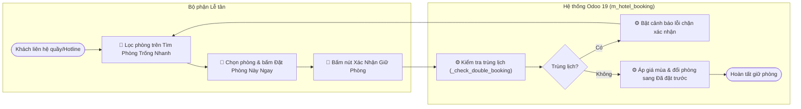

*Hình 3.1: Sơ đồ BPMN quy trình Đặt phòng tại quầy Lễ tân (6 Task, 1 Gateway)*

### 3.2.2. Đặc tả quy trình và Thư viện dữ liệu

#### 3.2.2.1. Đặc tả các bước của quy trình

**Bảng 3.2: Đặc tả các bước quy trình Đặt phòng tại quầy Lễ tân**

| STT | Tác nhân | Loại Task BPMN | Tên hộp trên BPMN | Mô tả xử lý trên Odoo 19 |
| :-: | :--- | :---: | :--- | :--- |
| 1 | Bộ phận Lễ tân | `User Task` | Lọc phòng trên Tìm Phòng Trống Nhanh | Mở wizard `Tìm Phòng Trống Nhanh`, chọn chi nhánh, hạng phòng, hình thức thuê, khung thời gian và bấm *Kiểm Tra Phòng Trống*. |
| 2 | Bộ phận Lễ tân | `User Task` | Chọn phòng & bấm Đặt Phòng Này Ngay | Chọn 1 phòng trong danh sách phòng trống khả dụng và nhấn **Đặt Phòng Này Ngay** để tạo đơn `Dự thảo` (`draft`). |
| 3 | Bộ phận Lễ tân | `User Task` | Bấm nút Xác Nhận Giữ Phòng | Chọn khách hàng, nhập `Tiền đặt cọc` (nếu khách nộp cọc) và nhấn **Xác Nhận Giữ Phòng** (`action_confirm`). |
| 4 | Hệ thống Odoo 19 | `Service & Gateway` | Kiểm tra trùng lịch (`_check_double_booking`) | Quét kiểm tra giao thoa ngày/giờ với tất cả đơn hiệu lực của phòng đó. Nếu trùng $\rightarrow$ bước 5; nếu trống $\rightarrow$ bước 6. |
| 5 | Hệ thống Odoo 19 | `Service Task` | Bật cảnh báo lỗi chặn xác nhận | Ném ngoại lệ `ValidationError` ghi rõ mã đơn đang chiếm phòng và chặn lưu xác nhận. |
| 6 | Hệ thống Odoo 19 | `Service Task` | Áp giá mùa & đổi phòng sang Đã đặt trước | Tự động áp giá mùa (`hotel.room.rate`), đổi đơn sang `Đã xác nhận` và chuyển màu phòng sang vàng `Đã đặt trước`. |

#### 3.2.2.2. Đặc tả thư viện dữ liệu

**Bảng 3.3: Đặc tả dữ liệu Hồ sơ khách (`res.partner`), Biểu giá mùa (`hotel.room.rate`) và Đơn đặt phòng (`hotel.booking`)**

| STT | Mô hình dữ liệu | Tên trường giao diện | Tên kỹ thuật | Ý nghĩa & Quy tắc nghiệp vụ |
| :-: | :--- | :--- | :--- | :--- |
| 1 | `res.partner` | CCCD / Phân loại khách | `id_card_number`, `hotel_guest_type` | Định danh khách lưu trú và phân hạng `Tiêu chuẩn / VIP / Cảnh báo`. |
| 2 | `hotel.room.rate` | Tên biểu giá & Kỳ áp dụng | `name`, `start_date`, `end_date` | Cấu hình khung giá ưu tiên dịp lễ, cuối tuần, mùa cao điểm theo hạng phòng. |
| 3 | `hotel.booking` | Mã đặt phòng | `name` | Chuỗi định danh tự sinh qua sequence (`HB/2026/00001`). |
| 4 | `hotel.booking` | Cơ sở & Phòng xếp chỗ | `company_id`, `room_id` | Chi nhánh khách sạn và số phòng cụ thể được giữ chỗ. |
| 5 | `hotel.booking` | Hình thức & Thời lượng thuê | `rent_type`, `nights_count`, `hours_duration` | Hỗ trợ tính tiền linh hoạt theo số đêm (`night`) hoặc theo số giờ (`hour`). |
| 6 | `hotel.booking` | Tiền đặt cọc & Còn lại | `deposit_amount`, `amount_residual` | Tự động tính `Còn lại thanh toán = Tổng cộng - Tiền đặt cọc`. |

*[Hình 3.2: Giao diện Wizard Tìm Phòng Trống Nhanh và Phiếu đặt phòng trên Odoo 19]*

### 3.2.3. Minh họa trên phần mềm Odoo và Xử lý ngoại lệ

#### 3.2.3.1. Các bước thực thi nghiệp vụ chuẩn
- **Bước 1:** Vào `Lễ Tân & Đặt Phòng ➔ Tìm Phòng Trống Nhanh`, bấm **Kiểm Tra Phòng Trống**. *(Hình 3.3)*
- **Bước 2:** Chọn `P.101`, bấm **Đặt Phòng Này Ngay** để mở phiếu nháp `HB/2026/...`. *(Hình 3.4)*
- **Bước 3:** Nhập tiền cọc và bấm **Xác Nhận Giữ Phòng** $\rightarrow$ Phòng `P.101` chuyển sang màu vàng `Đã đặt trước`. *(Hình 3.5)*

#### 3.2.3.2. Xử lý các tình huống ngoại lệ
- **a. Chặn đặt trùng phòng (Overbooking):** Khi cố tình xác nhận đơn đè vào khung ngày của đơn khác trên cùng phòng `P.101`, Odoo bật hộp thoại báo lỗi chặn thao tác; Lễ tân đổi sang `P.102` và xác nhận lại thành công. *(Hình 3.6)*
- **b. Hủy đặt phòng (`Hủy Đặt Phòng`):** Khi khách báo hủy chuyến đi, Lễ tân nhấn **Hủy Đặt Phòng** (`action_cancel`); đơn sang `Đã hủy` và phòng tự động giải phóng về `Sẵn sàng`. *(Hình 3.7)*

---

## 3.3. Quy trình Nhận phòng (Check-in)

Quy trình này chỉ có **một mục tiêu**: chuyển một đơn đặt phòng đã xác nhận (`confirmed`) sang trạng thái khách **đang lưu trú** (`check_in`). Tác nhân là **Bộ phận Lễ tân** (`group_hotel_receptionist`). Odoo tự kiểm tra tình trạng phòng trước khi cho nhận phòng (`action_check_in`).

### 3.3.1. Sơ đồ BPMN

- **Số làn:** 2 làn (`Bộ phận Lễ tân`, `Hệ thống Odoo 19`).
- **Quy mô:** 5 hộp Task + 1 Gateway.

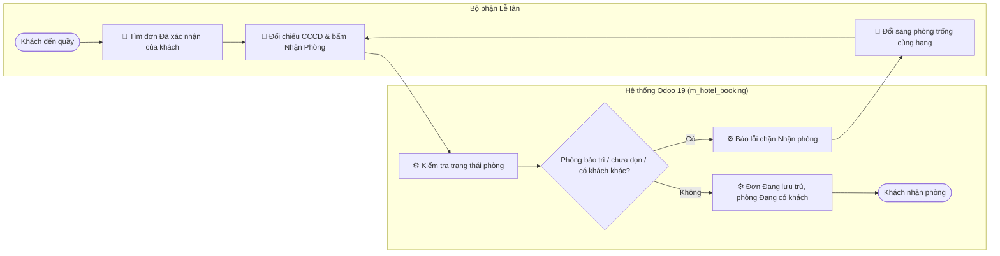

*Hình 3.8: Sơ đồ BPMN quy trình Nhận phòng (5 Task, 1 Gateway)*

### 3.3.2. Đặc tả quy trình và Thư viện dữ liệu

#### 3.3.2.1. Đặc tả các bước của quy trình

**Bảng 3.4: Đặc tả các bước quy trình Nhận phòng**

| STT | Tác nhân | Loại Task BPMN | Tên hộp trên BPMN | Mô tả xử lý trên Odoo 19 |
| :-: | :--- | :---: | :--- | :--- |
| 1 | Bộ phận Lễ tân | `User Task` | Tìm đơn Đã xác nhận của khách | Mở `Lễ Tân & Đặt Phòng ➔ Đơn đặt phòng`, tìm theo tên/SĐT khách hoặc mã `HB/...` ở trạng thái `Đã xác nhận`. |
| 2 | Bộ phận Lễ tân | `User Task` | Đối chiếu CCCD & bấm Nhận Phòng | Đối chiếu giấy tờ, cập nhật số CCCD trên hồ sơ khách (`id_card_number`) và bấm **Nhận Phòng** (`action_check_in`). |
| 3 | Hệ thống Odoo 19 | `Service Task` + `Gateway` | Kiểm tra trạng thái phòng | Nếu phòng đang `Bảo trì` / `Khóa tạm thời` / `Cần dọn dẹp`, hoặc đang `Đang có khách` mà `current_guest` khác khách của đơn ➔ bước 4; ngược lại ➔ bước 6. |
| 4 | Hệ thống Odoo 19 | `Service Task` | Báo lỗi chặn Nhận phòng | Ném `UserError` (VD: *"Phòng P.101 đang bảo trì hoặc tạm khóa, không thể nhận phòng!"*), đơn giữ nguyên trạng thái. |
| 5 | Bộ phận Lễ tân | `User Task` | Đổi sang phòng trống cùng hạng | Sửa trường `Phòng xếp chỗ` (`room_id`) sang phòng trống cùng hạng rồi bấm lại **Nhận Phòng**. |
| 6 | Hệ thống Odoo 19 | `Service Task` | Đơn Đang lưu trú, phòng Đang có khách | Đổi đơn sang `Đang lưu trú` (`check_in`), phòng sang `Đang có khách` (`occupied`, màu đỏ) và gán `current_guest` = tên khách. |

#### 3.3.2.2. Đặc tả thư viện dữ liệu

**Bảng 3.5: Đặc tả dữ liệu thay đổi khi Nhận phòng (`hotel.booking`, `hotel.room`)**

| STT | Mô hình dữ liệu | Tên trường giao diện | Tên kỹ thuật | Giá trị trước ➔ sau Nhận phòng |
| :-: | :--- | :--- | :--- | :--- |
| 1 | `hotel.booking` | Trạng thái đơn | `state` | `confirmed` ➔ `check_in` |
| 2 | `hotel.booking` | Phòng xếp chỗ | `room_id` | Có thể được đổi ở bước 5 |
| 3 | `hotel.room` | Tình trạng phòng | `status` | `reserved` / `available` ➔ `occupied` |
| 4 | `hotel.room` | Khách đang ở | `current_guest` | Trống ➔ Tên khách (`partner_id.name`) |
| 5 | `res.partner` | Số CCCD | `id_card_number` | Được lễ tân bổ sung/đối chiếu |

*[Hình 3.9: Giao diện đơn đặt phòng trạng thái Đang lưu trú và sơ đồ phòng màu đỏ trên Odoo 19]*

### 3.3.3. Minh họa trên phần mềm Odoo và Xử lý ngoại lệ

#### 3.3.3.1. Các bước thực thi nghiệp vụ chuẩn
- **Bước 1:** Mở đơn `HB/2026/...` trạng thái `Đã xác nhận`. *(Hình 3.10)*
- **Bước 2:** Bấm **Nhận Phòng** ➔ thẻ phòng trên sơ đồ phòng chuyển sang màu đỏ `Đang có khách`. *(Hình 3.11)*

#### 3.3.3.2. Xử lý các tình huống ngoại lệ
- **a. Phòng đang bảo trì, khóa tạm hoặc chưa dọn xong:** Odoo chặn bằng `UserError`; lễ tân đổi `Phòng xếp chỗ` sang phòng trống cùng hạng (đã thể hiện bằng Gateway trên sơ đồ). *(Hình 3.12)*
- **b. Đổi phòng khi khách đang lưu trú (`Room Move`):** Nếu trong thời gian ở phòng phát sinh sự cố, lễ tân sửa `Phòng xếp chỗ` trên đơn để chuyển khách sang phòng trống cùng hạng. *(Hình 3.13)*

---

## 3.4. Quy trình Ghi nhận dịch vụ phát sinh và Minibar trong lúc lưu trú

Quy trình này có **một mục tiêu**: cập nhật kịp thời các dịch vụ khách sử dụng thêm và đồ uống/ăn nhẹ **Minibar** trong suốt thời gian khách `Đang lưu trú` (`check_in`) vào tab **`Dịch Vụ & Minibar` (`hotel.booking.line`)**, kiểm tra cảnh báo tồn kho Minibar trước khi phục vụ và tự động cộng dồn vào tổng tiền trên đơn đặt phòng.

### 3.4.1. Sơ đồ BPMN

- **Số làn:** 2 làn (`Bộ phận Lễ tân`, `Hệ thống Odoo 19`).
- **Quy mô:** 5 hộp Task + 1 Gateway.

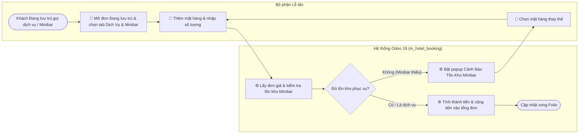

*Hình 3.14: Sơ đồ BPMN quy trình Ghi nhận dịch vụ phát sinh và Minibar trong lúc lưu trú (5 Task, 1 Gateway)*

### 3.4.2. Đặc tả quy trình, Danh mục dịch vụ và Thư viện dữ liệu

#### 3.4.2.1. Đặc tả các bước của quy trình

**Bảng 3.6: Đặc tả các bước quy trình Ghi nhận dịch vụ phát sinh và Minibar trong lúc lưu trú**

| STT | Tác nhân | Loại Task BPMN | Tên hộp trên BPMN | Mô tả xử lý trên Odoo 19 |
| :-: | :--- | :---: | :--- | :--- |
| 1 | Bộ phận Lễ tân | `User Task` | Mở đơn Đang lưu trú & chọn tab Dịch Vụ & Minibar | Mở `Lễ Tân & Đặt Phòng ➔ Đơn Đặt Phòng`, lọc đơn trạng thái `Đang lưu trú` của phòng tương ứng và chuyển sang tab `Dịch Vụ & Minibar`. |
| 2 | Bộ phận Lễ tân | `User Task` | Thêm mặt hàng & nhập số lượng | Bấm **Thêm một dòng**, chọn mặt hàng trong 21 dịch vụ / đồ Minibar khả dụng và nhập số lượng khách gọi. |
| 3 | Hệ thống Odoo 19 | `Service Task` + `Gateway` | Lấy đơn giá & kiểm tra tồn kho Minibar | Hàm `_onchange_product_id` tự điền `name` và `price_unit = lst_price`. Nếu `is_hotel_minibar = True`, kiểm tra `qty_available < quantity`; nếu thiếu ➔ bước 4, nếu đủ (hoặc là dịch vụ) ➔ bước 6. |
| 4 | Hệ thống Odoo 19 | `Service Task` | Bật popup Cảnh Báo Tồn Kho Minibar | Hiển thị cảnh báo rõ số tồn hiện có so với số lượng yêu cầu để Lễ tân báo khách đổi món hoặc liên hệ Kho bổ sung trước khi phục vụ. |
| 5 | Bộ phận Lễ tân | `User Task` | Chọn mặt hàng thay thế | Đổi `product_id` sang mặt hàng còn hàng tương ứng hoặc điều chỉnh lại số lượng. |
| 6 | Hệ thống Odoo 19 | `Service Task` | Tính thành tiền & cộng dồn vào tổng đơn | Tự động tính `price_subtotal = quantity × price_unit`, cập nhật `amount_services`, `amount_total` và `amount_residual` trên đơn đặt phòng. |

#### 3.4.2.2. Danh mục Dịch vụ khách sạn và Đồ Minibar triển khai trên Odoo 19

Hệ thống phân tách danh mục tính tiền phát sinh qua 2 cờ thuộc tính trên `product.template` (`is_hotel_service` và `is_hotel_minibar` — tách biệt với `is_hotel_supply` là vật tư tiêu hao miễn phí theo phòng), gồm **21 mặt hàng đang hoạt động** (`9` dịch vụ/phụ thu và `12` đồ Minibar nguyên bản) trong cơ sở dữ liệu `mhotel_dev`:

**Bảng 3.7: Danh mục Dịch vụ khách sạn và Đồ Minibar trên hệ thống M-Hotel**

| Phân nhóm trên Odoo | Mặt hàng đang hoạt động trong hệ thống | Đơn giá niêm yết | Quy tắc xử lý trên Folio |
| :--- | :--- | :---: | :--- |
| **1. Dịch vụ khách sạn & Phụ thu** (`is_hotel_service = True`, **9 dịch vụ**) | • **Dịch vụ & tiện ích (6 dịch vụ):** Cà phê sữa đá Sài Gòn truyền thống (`50.000 ₫`), Giặt ủi quần áo (`60.000 ₫`), Suất ăn sáng tại phòng - Phở / Bánh mì (`60.000 ₫`), Nước ép cam sành tươi nguyên chất (`65.000 ₫`), Thuê xe máy Honda Air Blade 1 ngày (`150.000 ₫`), Đưa đón sân bay 7 chỗ (`350.000 ₫`). • **Phụ thu & đền bù (3 khoản):** Phụ thu nhận phòng sớm / trả phòng trễ theo giờ (`100.000 ₫`), Phụ thu thêm người / kê nệm phụ (`150.000 ₫`), Phí đền bù mất thẻ từ / hư hỏng đồ (`150.000 ₫`). | `50.000 ₫` – `350.000 ₫` | Phục vụ hoặc phụ thu trực tiếp; hệ thống tự lấy `lst_price`, nhân `quantity` và cộng vào `amount_services` (không cảnh báo tồn kho). |
| **2. Đồ Minibar** (`is_hotel_minibar = True`, **12 mặt hàng**) | • **Đồ uống (7 mặt hàng):** Nước khoáng Lavie 500ml (`20.000 ₫`), Nước ngọt lon các loại (`20.000 ₫`), Nước ngọt Coca-Cola 320ml (`30.000 ₫`), Nước tăng lực Red Bull 250ml (`35.000 ₫`), Bia Heineken lon 330ml (`40.000 ₫`), Bia Tiger Crystal lon 330ml (`40.000 ₫`), Nước khoáng cao cấp Perrier có ga (`65.000 ₫`). • **Đồ ăn nhẹ (5 mặt hàng):** Mì ly Modern lẩu thái tôm (`25.000 ₫`), Thanh sô-cô-la bánh xốp ngọt ngào (`30.000 ₫`), Snack khoai tây lon (`50.000 ₫`), Khoai tây chiên lon giòn tan 100g (`50.000 ₫`), Hạt điều rang muối cao cấp 150g (`75.000 ₫`). | `20.000 ₫` – `75.000 ₫` | Tự động kiểm tra tồn kho khả dụng (`qty_available`); nếu vượt tồn kho, bật popup **Cảnh Báo Tồn Kho Minibar** trước khi phục vụ. |

#### 3.4.2.3. Đặc tả thư viện dữ liệu

**Bảng 3.8: Đặc tả dữ liệu Chi tiết dịch vụ Folio (`hotel.booking.line`)**

| STT | Tên trường giao diện | Tên kỹ thuật | Kiểu dữ liệu | Ý nghĩa & Quy tắc nghiệp vụ |
| :-: | :--- | :--- | :--- | :--- |
| 1 | Đơn đặt phòng | `booking_id` | `Many2one` | Liên kết đơn đặt phòng gốc (`ondelete='cascade'`). |
| 2 | Dịch vụ / Hàng tiêu dùng | `product_id` | `Many2one` | Chỉ lọc các sản phẩm bật cờ `is_hotel_service = True` hoặc `is_hotel_minibar = True`. |
| 3 | Diễn giải | `name` | `Char` | Tên dịch vụ, được sao chép sang dòng hóa đơn khi xuất hóa đơn. |
| 4 | Số lượng & Đơn giá | `quantity`, `price_unit` | `Float` | Số lượng phục vụ và đơn giá bán kế thừa từ `lst_price` (Lễ tân có thể sửa nếu thỏa thuận riêng). |
| 5 | Thành tiền | `price_subtotal` | `Float` | Tự động tính `quantity × price_unit` và cộng vào `amount_services`. |

*[Hình 3.15: Giao diện tab Dịch Vụ & Minibar ghi nhận dịch vụ phát sinh trên đơn Đang lưu trú]*

### 3.4.3. Minh họa trên phần mềm Odoo và Xử lý ngoại lệ

#### 3.4.3.1. Các bước thực thi nghiệp vụ chuẩn
- **Bước 1:** Mở đơn `HB/2026/...` đang ở trạng thái `Đang lưu trú`, vào tab *Dịch Vụ & Minibar*. *(Hình 3.16)*
- **Bước 2:** Bấm **Thêm một dòng**, chọn dịch vụ/đồ uống *(VD: Giặt ủi, Suất ăn sáng, Bia Heineken, Nước khoáng Lavie...)* ➔ Odoo tự điền đơn giá và cộng dồn vào `Tiền dịch vụ`. *(Hình 3.17)*

#### 3.4.3.2. Xử lý các tình huống ngoại lệ
- **a. Cảnh báo thiếu tồn kho Minibar trước khi phục vụ:** Khi số lượng đồ Minibar nhập vào lớn hơn tồn kho khả dụng (`qty_available < quantity`), `_onchange_product_id` bật hộp thoại **Cảnh Báo Tồn Kho Minibar** (đã thể hiện bằng nhánh Gateway trên sơ đồ). *(Hình 3.18)*
- **b. Phát sinh nhiều lần trong suốt kỳ lưu trú:** Khách gọi thêm dịch vụ qua nhiều ngày khác nhau đều được Lễ tân ghi nối tiếp vào cùng tab *Dịch Vụ & Minibar* trên đơn `Đang lưu trú` đó mà không phải tạo đơn mới. *(Hình 3.19)*

---

## 3.5. Quy trình Trả phòng (Check-out)

Quy trình này có **một mục tiêu**: kết thúc lượt lưu trú trên đơn đặt phòng (`check_out`), chuyển phòng sang trạng thái `Cần dọn dẹp` và tự động sinh nhiệm vụ buồng phòng (`HK/...`). Tác nhân là **Bộ phận Lễ tân** (`group_hotel_receptionist`) trên module `m_hotel_booking`. Việc lập hóa đơn và thu tiền sau khi trả phòng được thực hiện ở quy trình `3.6`.

### 3.5.1. Sơ đồ BPMN

- **Số làn:** 2 làn (`Bộ phận Lễ tân`, `Hệ thống Odoo 19`).
- **Quy mô:** 4 hộp Task thẳng tuyến tính, **0 Gateway**.

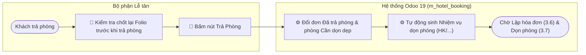

*Hình 3.20: Sơ đồ BPMN quy trình Trả phòng (4 Task, 0 Gateway)*

### 3.5.2. Đặc tả quy trình và Thư viện dữ liệu

#### 3.5.2.1. Đặc tả các bước của quy trình

**Bảng 3.9: Đặc tả các bước quy trình Trả phòng**

| STT | Tác nhân | Loại Task BPMN | Tên hộp trên BPMN | Mô tả xử lý trên Odoo 19 |
| :-: | :--- | :---: | :--- | :--- |
| 1 | Bộ phận Lễ tân | `User Task` | Kiểm tra chốt lại Folio trước khi trả phòng | Mở đơn `Đang lưu trú`, rà lại tab `Dịch Vụ & Minibar` và bổ sung các món Minibar khách dùng tại phòng chưa ghi nhận ở quy trình `3.4`. |
| 2 | Bộ phận Lễ tân | `User Task` | Bấm nút Trả Phòng | Nhận lại thẻ phòng và nhấn nút **Trả Phòng** (`action_check_out`). |
| 3 | Hệ thống Odoo 19 | `Service Task` | Đổi đơn Đã trả phòng & phòng Cần dọn dẹp | Đổi trạng thái đơn sang `Đã trả phòng` (`check_out`), xóa `current_guest` và đổi thẻ phòng sang màu xanh dương `Cần dọn dẹp` (`cleaning`). |
| 4 | Hệ thống Odoo 19 | `Service Task` | Tự động sinh Nhiệm vụ dọn phòng (`HK/...`) | Gọi hook `_auto_create_housekeeping_task()` khởi tạo phiếu dọn phòng cột `Chờ xử lý` đẩy sang quy trình `3.7` của Bộ phận Buồng phòng. |

#### 3.5.2.2. Đặc tả thư viện dữ liệu

**Bảng 3.10: Đặc tả dữ liệu cập nhật trạng thái khi Trả phòng (`hotel.booking`, `hotel.room`)**

| STT | Mô hình dữ liệu | Tên trường giao diện | Tên kỹ thuật | Giá trị trước ➔ sau Trả phòng |
| :-: | :--- | :--- | :--- | :--- |
| 1 | `hotel.booking` | Trạng thái đơn | `state` | `check_in` (`Đang lưu trú`) ➔ `check_out` (`Đã trả phòng`) |
| 2 | `hotel.booking` | Tiền dịch vụ & Tổng cộng | `amount_services`, `amount_total` | Chốt lại theo tổng giá trị tab Folio (`hotel.booking.line`) |
| 3 | `hotel.room` | Tình trạng phòng | `status` | `occupied` (`Đang có khách`) ➔ `cleaning` (`Cần dọn dẹp`) |
| 4 | `hotel.room` | Khách đang ở | `current_guest` | Tên khách ➔ Trống (`False`) |

*[Hình 3.21: Giao diện đơn đặt phòng Đã trả phòng và trạng thái phòng Cần dọn dẹp trên sơ đồ]*

### 3.5.3. Minh họa trên phần mềm Odoo và Xử lý ngoại lệ

#### 3.5.3.1. Các bước thực thi nghiệp vụ chuẩn
- **Bước 1:** Trên đơn `Đang lưu trú`, kiểm tra lần cuối các dòng trong tab *Dịch Vụ & Minibar*. *(Hình 3.22)*
- **Bước 2:** Bấm **Trả Phòng** ➔ đơn chuyển `Đã trả phòng`, phòng đổi sang `Cần dọn dẹp` và tự động sinh nhiệm vụ dọn phòng `HK/...`. *(Hình 3.23)*

#### 3.5.3.2. Xử lý các tình huống ngoại lệ
- **a. Bổ sung đồ Minibar phát hiện muộn sau khi đã bấm Trả phòng:** Nếu bấm **Trả Phòng** xong mới nhận được báo cáo khách dùng thêm đồ Minibar, khi chưa xuất hóa đơn (`state = 'check_out'`), Lễ tân vẫn thêm dòng vào tab *Dịch Vụ & Minibar* để cập nhật đúng `amount_total` trước khi qua bước `3.6`. *(Hình 3.24)*

---

## 3.6. Quy trình Lập hóa đơn và Thu tiền khách hàng

Quy trình này có **một mục tiêu**: tạo **Hóa đơn khách hàng** (`account.move` – `out_invoice`) từ đơn đặt phòng, xác nhận vào sổ (`INV/...`) và ghi nhận thanh toán hoàn tất. Toàn bộ quy trình diễn ra nối tiếp nhau trên giao diện Hóa đơn ngay sau khi bấm `Tạo Hóa Đơn Khách Hàng`. Tác nhân thực hiện tại quầy là **Bộ phận Lễ tân** (`group_hotel_receptionist` kế thừa quyền `account.group_account_invoice` trong `m_hotel_base/security/security.xml` để thao tác trên phân hệ `Hóa đơn - Invoicing`).

### 3.6.1. Sơ đồ BPMN

- **Số làn:** 2 làn (`Bộ phận Lễ tân`, `Hệ thống Odoo 19`).
- **Quy mô:** 6 hộp Task thẳng tuyến tính, **0 Gateway**.

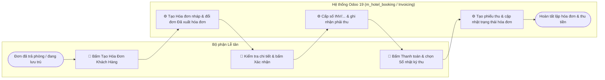

*Hình 3.25: Sơ đồ BPMN quy trình Lập hóa đơn và Thu tiền khách hàng (6 Task, 0 Gateway)*

### 3.6.2. Đặc tả quy trình và Thư viện dữ liệu

#### 3.6.2.1. Đặc tả các bước của quy trình

**Bảng 3.11: Đặc tả các bước quy trình Lập hóa đơn và Thu tiền khách hàng**

| STT | Tác nhân | Loại Task BPMN | Tên hộp trên BPMN | Mô tả xử lý trên Odoo 19 |
| :-: | :--- | :---: | :--- | :--- |
| 1 | Bộ phận Lễ tân | `User Task` | Bấm Tạo Hóa Đơn Khách Hàng | Trên phiếu đặt phòng, bấm nút **Tạo Hóa Đơn Khách Hàng** (`action_create_invoice`). |
| 2 | Hệ thống Odoo 19 | `Service Task` | Tạo Hóa đơn nháp & đổi đơn Đã xuất hóa đơn | Sinh `account.move` (`out_invoice`, trạng thái `Nháp`) gồm dòng tiền phòng + các dòng Folio + dòng âm khấu trừ `deposit_amount` (nếu có), gán `hotel_booking_id`, lưu `invoice_id`, đổi đơn sang `Đã xuất hóa đơn` (`invoiced`) và mở ngay form Hóa đơn. |
| 3 | Bộ phận Lễ tân | `User Task` | Kiểm tra chi tiết & bấm Xác nhận | Kiểm tra các dòng tiền phòng, dịch vụ Folio trên form Hóa đơn vừa mở rồi bấm **Xác nhận** (`action_post`). |
| 4 | Hệ thống Odoo 19 | `Service Task` | Cấp số `INV/...` & ghi nhận phải thu | Cấp số chứng từ `INV/2026/...`, chuyển hóa đơn sang `Đã vào sổ` và ghi nhận doanh thu, công nợ phải thu của khách. |
| 5 | Bộ phận Lễ tân | `User Task` | Bấm Thanh toán & chọn Sổ nhật ký thu | Bấm nút **Thanh toán**, chọn sổ `Tiền mặt` hoặc `Ngân hàng`, kiểm tra số tiền thực thu và bấm **Tạo thanh toán**. |
| 6 | Hệ thống Odoo 19 | `Service Task` | Tạo phiếu thu & cập nhật trạng thái hóa đơn | Tạo `account.payment`, đối soát với hóa đơn `INV/...` và gắn ruy-băng **Đã thanh toán** *(hoặc **Đang thanh toán** tùy cấu hình sổ Ngân hàng)*. |

#### 3.6.2.2. Đặc tả thư viện dữ liệu

**Bảng 3.12: Đặc tả dữ liệu Hóa đơn khách hàng (`account.move` – `out_invoice`) và Phiếu thu (`account.payment`)**

| STT | Mô hình dữ liệu | Tên trường giao diện | Tên kỹ thuật | Ý nghĩa & Quy tắc nghiệp vụ |
| :-: | :--- | :--- | :--- | :--- |
| 1 | `hotel.booking` | Hóa đơn khách hàng | `invoice_id` | Lưu liên kết đến hóa đơn vừa tạo; smart button **Hóa đơn** dùng trường này. |
| 2 | `account.move` | Số hóa đơn | `name` | Tự sinh khi xác nhận (`INV/2026/00019`). |
| 3 | `account.move` | Đơn đặt phòng liên quan | `hotel_booking_id` | Trường mở rộng trong `m_hotel_booking`, liên kết ngược về đơn `HB/...`. |
| 4 | `account.move` | Chi tiết hóa đơn | `invoice_line_ids` | Tự động tạo dòng tiền phòng (`room_price × số đêm/giờ`), các dòng Folio và dòng âm khấu trừ tiền đặt cọc (`-deposit_amount` nếu có). |
| 5 | `account.move` | Tổng & Số tiền phải trả | `amount_total`, `amount_residual` | Tổng giá trị hóa đơn và số dư khách còn phải thanh toán. |
| 6 | `account.move` | Trạng thái thanh toán | `payment_state` | `not_paid` ➔ `partial` (`Một phần`) ➔ `in_payment` (`Đang thanh toán`) / `paid` (`Đã thanh toán`). |
| 7 | `account.payment` | Sổ nhật ký & Số tiền | `journal_id`, `amount` | Quỹ `Tiền mặt` / `Ngân hàng` và số tiền thu tương ứng. |

*[Hình 3.26: Giao diện Hóa đơn INV/... đã xác nhận và ghi nhận thanh toán trên Odoo 19]*

### 3.6.3. Minh họa trên phần mềm Odoo và Xử lý ngoại lệ

#### 3.6.3.1. Các bước thực thi nghiệp vụ chuẩn
- **Bước 1:** Trên đơn `Đã trả phòng`, bấm **Tạo Hóa Đơn Khách Hàng** ➔ Odoo tạo Hóa đơn nháp và mở thẳng giao diện hóa đơn. *(Hình 3.27)*
- **Bước 2:** Kiểm tra tiền phòng và các dòng dịch vụ Folio ➔ bấm **Xác nhận** để cấp mã `INV/...`. *(Hình 3.28)*
- **Bước 3:** Bấm **Thanh toán** ➔ chọn `Tiền mặt` / `Ngân hàng` ➔ bấm **Tạo thanh toán** để hoàn tất thu tiền (có thể bấm **In** / **Gửi** giao hóa đơn cho khách). *(Hình 3.29)*

#### 3.6.3.2. Xử lý các tình huống ngoại lệ
- **a. Khách đã nộp tiền cọc trước (`deposit_amount`):** Khi bấm **Tạo Hóa Đơn Khách Hàng**, hàm `action_create_invoice()` tự động kiểm tra nếu `deposit_amount > 0` sẽ chèn thêm một dòng âm **"Khấu trừ tiền đặt cọc đã thu trước"** (tối đa bằng tổng giá trị lưu trú), giúp `Tổng` và `Số tiền phải trả` trên Hóa đơn nháp khớp ngay với số còn lại (`amount_residual`) để Lễ tân thu gọn trong một lần. *(Hình 3.30)*
- **b. Xuất hóa đơn sớm khi khách đang lưu trú & chống xuất trùng:** Điều kiện hiển thị nút (`state in ('check_out', 'check_in') and not invoice_id`) cho phép xuất hóa đơn thanh toán trước khi khách check-out; sau khi đã có `invoice_id`, nút tạo mới tự ẩn trên giao diện (chỉ còn Smart button **Hóa đơn** và kiểm tra `if self.invoice_id` ở backend) để tránh xuất trùng chứng từ. *(Hình 3.31)*
- **c. Giảm trừ / hoàn tiền sau khi đã vào sổ (`Giấy báo có`):** Khi cần điều chỉnh giảm do khiếu nại dịch vụ hoặc hoàn lại khoản thu thừa trên hóa đơn đã vào sổ, bấm nút **Giấy báo có** (`action_reverse`), nhập lý do và xác nhận chứng từ `RINV/...` để cấn trừ hoặc hoàn tiền cho khách. *(Hình 3.32)*

---

## 3.7. Quy trình Điều phối dọn buồng phòng

Quy trình này thuộc phạm vi chuyên trách của **Bộ phận Buồng phòng** (`group_hotel_housekeeping`) trên module `m_hotel_housekeeping`: tiếp nhận nhiệm vụ dọn phòng tự động trên bảng Kanban, cập nhật tiến độ làm sạch và khôi phục trạng thái phòng về `Sẵn sàng` đón khách.

### 3.7.1. Sơ đồ BPMN

- **Số làn:** 2 làn (`Bộ phận Buồng phòng`, `Hệ thống Odoo 19`).
- **Quy mô:** 5 hộp Task thẳng tuyến tính, **0 Gateway**.

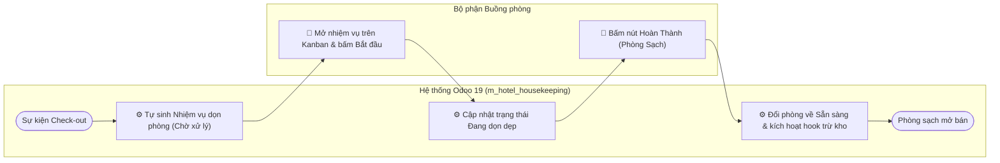

*Hình 3.33: Sơ đồ BPMN quy trình Điều phối dọn buồng phòng (5 Task, 0 Gateway)*

### 3.7.2. Đặc tả quy trình và Thư viện dữ liệu

#### 3.7.2.1. Đặc tả các bước của quy trình

**Bảng 3.13: Đặc tả các bước quy trình Điều phối dọn buồng phòng**

| STT | Tác nhân | Loại Task BPMN | Tên hộp trên BPMN | Mô tả xử lý trên Odoo 19 |
| :-: | :--- | :---: | :--- | :--- |
| 1 | Hệ thống Odoo 19 | `Service Task` | Tự sinh Nhiệm vụ dọn phòng (`Chờ xử lý`) | Tự động tạo bản ghi `hotel.housekeeping.task` (`HK/2026/...`) loại `Dọn sau trả phòng`, mức ưu tiên `Khẩn cấp (2 sao)`. |
| 2 | Bộ phận Buồng phòng | `User Task` | Mở nhiệm vụ trên Kanban & bấm Bắt đầu | Nhân viên mở `Bảng Nhiệm Vụ Dọn Phòng`, nhận phòng được giao và bấm **Bắt Đầu Dọn Dẹp** (`action_start`). |
| 3 | Hệ thống Odoo 19 | `Service Task` | Cập nhật trạng thái `Đang dọn dẹp` | Chuyển thẻ nhiệm vụ sang cột `Đang dọn dẹp` (`in_progress`) và đồng bộ phòng ở trạng thái `Cần dọn dẹp`. |
| 4 | Bộ phận Buồng phòng | `User Task` | Bấm nút Hoàn Thành (Phòng Sạch) | Sau khi hoàn tất vệ sinh phòng, nhân viên nhấn nút **Hoàn Thành (Phòng Sạch)** (`action_complete`). |
| 5 | Hệ thống Odoo 19 | `Service Task` | Đổi phòng về `Sẵn sàng` & kích hoạt hook trừ kho | Chuyển nhiệm vụ sang `Đã sạch & Sẵn sàng`, đổi thẻ phòng sang màu xanh lá `Sẵn sàng` và gọi tự động hàm `_consume_room_supplies()` sang phân hệ Kho. |

#### 3.7.2.2. Đặc tả thư viện dữ liệu

**Bảng 3.14: Đặc tả dữ liệu Nhiệm vụ buồng phòng (`hotel.housekeeping.task`)**

| STT | Tên trường giao diện | Tên kỹ thuật | Kiểu dữ liệu | Ý nghĩa & Quy tắc nghiệp vụ |
| :-: | :--- | :--- | :--- | :--- |
| 1 | Mã nhiệm vụ | `name` | `Char` | Mã định danh tự sinh qua sequence (`HK/2026/00001`), chỉ đọc. |
| 2 | Phòng & Hạng phòng | `room_id`, `room_type_id` | `Many2one` | Số phòng cần dọn dẹp và hạng phòng kế thừa tự động. |
| 3 | Loại công việc | `task_type` | `Selection` | `checkout_clean` (Sau trả phòng), `stayover_clean` (Đang ở), `deep_clean` (Tổng vệ sinh), `turndown` (Chỉnh trang tối). |
| 4 | Mức độ ưu tiên | `priority` | `Selection` | `0` (Bình thường), `1` (Ưu tiên), `2` (Khẩn cấp / Khách chờ nhận). |
| 5 | Nhân viên & Hạn hoàn thành | `user_id`, `date_deadline` | `Many2one`, `Datetime` | Nhân sự buồng phòng phụ trách và thời hạn hoàn tất. |
| 6 | Trạng thái | `state` | `Selection` | `Chờ xử lý` (`pending`), `Đang dọn dẹp` (`in_progress`), `Đã sạch & Sẵn sàng` (`done`), `Đã hủy` (`cancel`). |

*[Hình 3.34: Giao diện bảng Kanban điều phối Nhiệm vụ dọn phòng trên Odoo 19]*

### 3.7.3. Minh họa trên phần mềm Odoo và Xử lý ngoại lệ

#### 3.7.3.1. Các bước thực thi nghiệp vụ chuẩn
- **Bước 1:** Xem thẻ nhiệm vụ `HK/...` tự sinh ở cột `Chờ xử lý` ngay sau khi Lễ tân bấm *Trả phòng*. *(Hình 3.35)*
- **Bước 2:** Nhấn nút **Bắt Đầu Dọn Dẹp** $\rightarrow$ Thẻ chuyển sang cột `Đang dọn dẹp`. *(Hình 3.36)*
- **Bước 3:** Nhấn **Hoàn Thành (Phòng Sạch)** $\rightarrow$ Thẻ sang cột `Đã sạch & Sẵn sàng` và phòng trên sơ đồ đổi về màu xanh lá `Sẵn sàng`. *(Hình 3.37)*

#### 3.7.3.2. Xử lý các tình huống ngoại lệ
- **a. Tạo nhiệm vụ dọn phòng khách đang ở (`Stay-over`) / Chỉnh trang tối (`Turn-down`):** Trưởng ca chủ động bấm **Mới** tạo nhiệm vụ loại `Stay-over`; khi bấm *Hoàn thành*, điều kiện `if room.status != 'occupied'` trong code giữ nguyên trạng thái phòng là `Đang có khách` (không đổi nhầm thành phòng trống). *(Hình 3.38)*
- **b. Hủy nhiệm vụ dọn phòng tạo nhầm (`Hủy Nhiệm Vụ`):** Nhấn nút **Hủy Nhiệm Vụ** (`action_cancel`) để đóng phiếu sang trạng thái `Đã hủy` mà không kích hoạt trừ vật tư kho. *(Hình 3.39)*

---

## 3.8. Quy trình Xử lý sự cố buồng phòng (Bảo trì khắc phục – Corrective)

Quy trình này giải quyết các **hư hỏng phát sinh đột xuất** tại phòng nghỉ: nhân viên Buồng phòng/Lễ tân lập biên bản sự cố trên `hotel.incident`, hệ thống tự động khóa phòng khẩn cấp, chuyển lệnh sửa chữa kiểu **Khắc phục (`corrective`)** sang bộ phận Kỹ thuật và mở khóa phòng sau khi nghiệm thu.

### 3.8.1. Sơ đồ BPMN

- **Số làn:** 3 làn (`Bộ phận Buồng phòng`, `Hệ thống Odoo 19`, `Bộ phận Kỹ thuật`).
- **Quy mô:** 7 hộp Task + 1 Gateway.

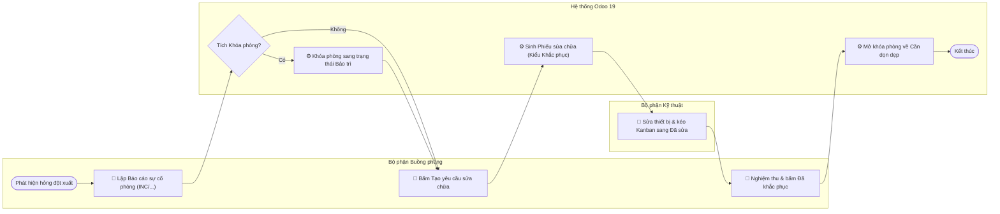

*Hình 3.40: Sơ đồ BPMN quy trình Xử lý sự cố buồng phòng (7 Task, 1 Gateway)*

### 3.8.2. Đặc tả quy trình và Thư viện dữ liệu

#### 3.8.2.1. Đặc tả các bước của quy trình

**Bảng 3.15: Đặc tả các bước quy trình Xử lý sự cố buồng phòng**

| STT | Tác nhân | Loại Task BPMN | Tên hộp trên BPMN | Mô tả xử lý trên Odoo 19 |
| :-: | :--- | :---: | :--- | :--- |
| 1 | Bộ phận Buồng phòng | `User Task` | Lập Báo cáo sự cố phòng (`INC/...`) | Vào `Báo Cáo Sự Cố Phòng ➔ Mới`, chọn số phòng, mức độ nghiêm trọng và bật `Khóa phòng` nếu lỗi làm phòng không thể đón khách. |
| 2 | Hệ thống Odoo 19 | `Gateway & Service` | Tích Khóa phòng? $\rightarrow$ Khóa phòng sang Bảo trì | Nếu `block_room = True`, tự động đổi trạng thái phòng sang màu cam `Bảo trì / Sửa chữa`, chặn Lễ tân xếp khách. |
| 3 | Bộ phận Buồng phòng | `User Task` | Bấm Tạo yêu cầu sửa chữa | Nhấn nút **Tạo Yêu Cầu Sửa Chữa (Kỹ Thuật)** (`action_create_maintenance_request`). |
| 4 | Hệ thống Odoo 19 | `Service Task` | Sinh Phiếu sửa chữa (Kiểu Khắc phục) | Tự sinh bản ghi `maintenance.request` kiểu `Khắc phục`, kế thừa số phòng, biên bản gốc, độ ưu tiên sao và đổi sự cố sang `Đang xử lý`. |
| 5 | Bộ phận Kỹ thuật | `User Task` | Sửa thiết bị & kéo Kanban sang Đã sửa | Kỹ thuật nhận phiếu trên bảng Kanban Bảo trì, chọn mã thiết bị hỏng, khắc phục xong và kéo sang cột `Đã sửa`. |
| 6 | Bộ phận Buồng phòng | `User Task` | Nghiệm thu & bấm Đã khắc phục | Kiểm tra lại thiết bị tại phòng, mở biên bản `INC/...` và nhấn **Đã Khắc Phục Hoàn Tất** (`action_resolve`). |
| 7 | Hệ thống Odoo 19 | `Service Task` | Mở khóa phòng về Cần dọn dẹp | Đổi sự cố sang `Đã khắc phục` và tự động chuyển phòng từ `Bảo trì` về `Cần dọn dẹp` để làm vệ sinh trước khi mở bán. |

#### 3.8.2.2. Đặc tả thư viện dữ liệu

**Bảng 3.16: Đặc tả dữ liệu Biên bản sự cố buồng phòng (`hotel.incident`)**

| STT | Tên trường giao diện | Tên kỹ thuật | Kiểu dữ liệu | Ý nghĩa & Quy tắc nghiệp vụ |
| :-: | :--- | :--- | :--- | :--- |
| 1 | Mã sự cố & Tiêu đề | `name`, `title` | `Char` | Mã tự sinh (`INC/2026/...`) và tóm tắt hiện tượng hỏng hóc. |
| 2 | Phòng xảy ra sự cố | `room_id` | `Many2one` | Liên kết `hotel.room`; tự động suy ra chi nhánh `company_id`. |
| 3 | Mức độ nghiêm trọng | `severity` | `Selection` | `Nhẹ` (`low`), `Trung bình` (`medium`), `Nghiêm trọng` (`critical`). |
| 4 | Khóa phòng | `block_room` | `Boolean` | Bật tự động khóa phòng sang `Bảo trì / Sửa chữa`. |
| 5 | Phiếu bảo trì Kỹ thuật | `maintenance_request_id` | `Many2one` | Liên kết sang chứng từ sửa chữa bên phân hệ Kỹ thuật. |
| 6 | Trạng thái | `state` | `Selection` | `Mới tiếp nhận`, `Đang xử lý`, `Đã khắc phục`, `Hủy`. |

*[Hình 3.41: Giao diện Biên bản sự cố buồng phòng và trạng thái phòng khóa Bảo trì trên Odoo 19]*

### 3.8.3. Minh họa trên phần mềm Odoo và Xử lý ngoại lệ

#### 3.8.3.1. Các bước thực thi nghiệp vụ chuẩn
- **Bước 1:** Tạo biên bản `INC/...` cho phòng `P.104`, bật công tắc **Khóa phòng** $\rightarrow$ Phòng trên sơ đồ chuyển sang màu cam `Bảo trì`. *(Hình 3.42)*
- **Bước 2:** Nhấn **Tạo Yêu Cầu Sửa Chữa (Kỹ Thuật)** để bàn giao phiếu sang Kanban Kỹ thuật. *(Hình 3.43)*
- **Bước 3:** Sau khi Kỹ thuật kéo sang `Đã sửa`, Buồng phòng nhấn **Đã Khắc Phục Hoàn Tất** $\rightarrow$ Phòng mở khóa về `Cần dọn dẹp`. *(Hình 3.44)*

#### 3.8.3.2. Xử lý các tình huống ngoại lệ
- **Sự cố nhẹ không khóa phòng (`Khóa phòng = Không`):** Với các lỗi nhỏ như thay pin điều khiển TV, nhân viên để trống ô `Khóa phòng`; phiếu sửa chữa vẫn chuyển sang Kỹ thuật nhưng phòng vẫn giữ nguyên trạng thái kinh doanh bình thường. *(Hình 3.45)*

---

## 3.9. Quy trình Bảo dưỡng định kỳ thiết bị (Bảo trì phòng ngừa – Preventive)

Độc lập với sự cố đột xuất ở mục `3.8`, quy trình này do **Bộ phận Kỹ thuật** (`group_hotel_maintenance`) chủ động thực hiện trên module `m_hotel_asset` & `maintenance`: quản lý danh mục tài sản gắn cố định theo từng phòng (`Serial No`) và lập lịch bảo dưỡng **Phòng ngừa (`preventive`)** định kỳ hàng tháng/quý.

### 3.9.1. Sơ đồ BPMN

- **Số làn:** 2 làn (`Bộ phận Kỹ thuật`, `Hệ thống Odoo 19`).
- **Quy mô:** 6 hộp Task + 1 Gateway.

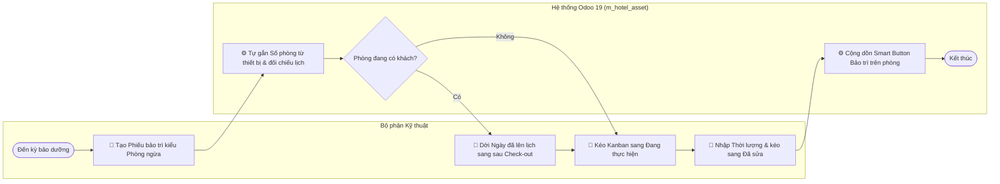

*Hình 3.46: Sơ đồ BPMN quy trình Bảo dưỡng định kỳ thiết bị (6 Task, 1 Gateway)*

### 3.9.2. Đặc tả quy trình và Thư viện dữ liệu

#### 3.9.2.1. Đặc tả các bước của quy trình

**Bảng 3.17: Đặc tả các bước quy trình Bảo dưỡng định kỳ thiết bị**

| STT | Tác nhân | Loại Task BPMN | Tên hộp trên BPMN | Mô tả xử lý trên Odoo 19 |
| :-: | :--- | :---: | :--- | :--- |
| 1 | Bộ phận Kỹ thuật | `User Task` | Tạo Phiếu bảo trì kiểu Phòng ngừa | Vào `Kỹ Thuật & Thiết Bị ➔ Phiếu Sửa Chữa Kỹ Thuật ➔ Mới`, chọn thiết bị cần bảo dưỡng, tích kiểu **Phòng ngừa** (`preventive`) và ấn định `Ngày đã lên lịch`. |
| 2 | Hệ thống Odoo 19 | `Service & Gateway` | Tự gắn Số phòng & đối chiếu lịch phòng | Kế thừa `room_id` từ hồ sơ thiết bị và kiểm tra trạng thái phòng tại thời điểm lên lịch. |
| 3 | Bộ phận Kỹ thuật | `User Task` | Dời Ngày đã lên lịch sang sau Check-out | *(Nếu phòng đang có khách lưu trú)* Điều chỉnh `schedule_date` sang khung giờ trống sau khi khách trả phòng. |
| 4 | Bộ phận Kỹ thuật | `User Task` | Kéo Kanban sang Đang thực hiện | Đến lịch hẹn, kỹ thuật viên kéo thẻ bảo dưỡng sang cột `Đang thực hiện`. |
| 5 | Bộ phận Kỹ thuật | `User Task` | Nhập Thời lượng & kéo sang Đã sửa | Nhập số giờ bảo dưỡng thực tế vào trường `Thời lượng`, ghi chú thông số kỹ thuật và kéo thẻ sang cột `Đã sửa`. |
| 6 | Hệ thống Odoo 19 | `Service Task` | Cộng dồn Smart Button Bảo trì trên phòng | Lưu lịch sử bảo dưỡng định kỳ của tài sản và tự động tăng bộ đếm trên Smart Button `Bảo trì` của hồ sơ phòng. |

#### 3.9.2.2. Đặc tả thư viện dữ liệu

**Bảng 3.18: Đặc tả dữ liệu Thiết bị phòng (`maintenance.equipment`), Phiếu bảo trì (`maintenance.request`) và Hồ sơ phòng (`hotel.room`)**

| STT | Mô hình dữ liệu | Tên trường giao diện | Tên kỹ thuật | Ý nghĩa & Quy tắc nghiệp vụ |
| :-: | :--- | :--- | :--- | :--- |
| 1 | `maintenance.equipment` | Tên thiết bị & Số sê-ri | `name`, `serial_no` | Tên tài sản (Điều hòa Daikin, Tivi Samsung...) và mã Serial duy nhất. |
| 2 | `maintenance.equipment` | Phòng đặt thiết bị | `room_id` | Gắn thiết bị cố định vào số phòng khách sạn (`P.104`, `P.205`...). |
| 3 | `maintenance.request` | Kiểu bảo dưỡng | `maintenance_type` | Phân loại `Phòng ngừa` (`preventive`) hoặc `Khắc phục` (`corrective`). |
| 4 | `maintenance.request` | Ngày đã lên lịch & Thời lượng | `schedule_date`, `duration` | Lịch hẹn bảo dưỡng định kỳ và số giờ thực hiện thực tế. |
| 5 | `hotel.room` | Smart Button Thiết bị & Bảo trì | `equipment_count`, `maintenance_count` | Thống kê tức thời số thiết bị lắp trong phòng và tổng số lượt bảo trì lũy kế. |

*[Hình 3.47: Giao diện Thiết bị theo từng phòng, Phiếu bảo dưỡng Phòng ngừa và Smart Button trên hồ sơ phòng]*

### 3.9.3. Minh họa trên phần mềm Odoo và Xử lý ngoại lệ

#### 3.9.3.1. Các bước thực thi nghiệp vụ chuẩn
- **Bước 1:** Mở `Thiết Bị Theo Từng Phòng`, xem chi tiết `Điều hòa Daikin 1.5HP` (`DAIKIN-15-104-GL`) tại phòng `P.104`. *(Hình 3.48)*
- **Bước 2:** Tạo phiếu bảo trì chọn kiểu **Phòng ngừa** và ấn định `Ngày đã lên lịch`. *(Hình 3.49)*
- **Bước 3:** Kéo thẻ sang `Đang thực hiện` $\rightarrow$ nhập `Thời lượng` $\rightarrow$ kéo sang `Đã sửa` và kiểm tra Smart Button `Bảo trì` trên phòng `P.104`. *(Hình 3.50)*

#### 3.9.3.2. Xử lý các tình huống ngoại lệ
- **Thanh lý thiết bị hết niên hạn (`Loại bỏ`):** Khi thiết bị xuống cấp không còn an toàn để vận hành, kỹ thuật viên kéo phiếu sang cột **Loại bỏ** trên Kanban, gỡ số phòng khỏi thiết bị cũ và gán thiết bị mới thay thế vào phòng. *(Hình 3.51)*

---

## 3.10. Quy trình Quản lý định mức và Xuất tiêu hao vật tư

Quy trình này thuộc phạm vi quản trị của **Bộ phận Kho** (`group_hotel_stock`) trên module `m_hotel_inventory`: thiết lập bảng định mức cấp phát đồ dùng cá nhân/nước uống cho từng hạng phòng và tự động ghi nhận chi tiết vật tư xuất dùng sau mỗi lượt dọn phòng để đối soát tồn kho.

### 3.10.1. Sơ đồ BPMN

- **Số làn:** 2 làn (`Bộ phận Kho`, `Hệ thống Odoo 19`).
- **Quy mô:** 6 hộp Task + 1 Gateway.

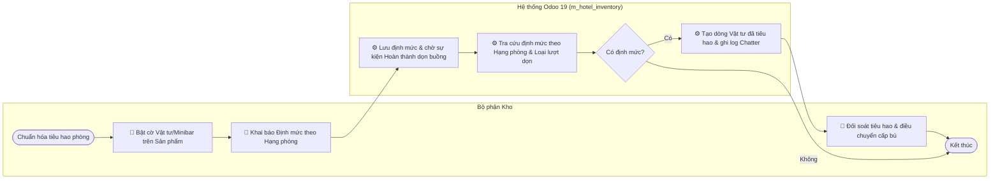

*Hình 3.52: Sơ đồ BPMN quy trình Quản lý định mức và Xuất tiêu hao vật tư (6 Task, 1 Gateway)*

### 3.10.2. Đặc tả quy trình và Thư viện dữ liệu

#### 3.10.2.1. Đặc tả các bước của quy trình

**Bảng 3.19: Đặc tả các bước quy trình Quản lý định mức và Xuất tiêu hao vật tư**

| STT | Tác nhân | Loại Task BPMN | Tên hộp trên BPMN | Mô tả xử lý trên Odoo 19 |
| :-: | :--- | :---: | :--- | :--- |
| 1 | Bộ phận Kho | `User Task` | Bật cờ Vật tư/Minibar trên Sản phẩm | Trên danh mục `Sản phẩm`, bật cờ `Vật tư buồng phòng` (`is_hotel_supply`) hoặc `Đồ Minibar` (`is_hotel_minibar`). |
| 2 | Bộ phận Kho | `User Task` | Khai báo Định mức theo Hạng phòng | Mở `Kho & Vật Tư ➔ Định Mức Vật Tư Tiêu Hao`, nhập số lượng chuẩn cho 1 lượt dọn theo từng hạng phòng và loại công việc. |
| 3 | Hệ thống Odoo 19 | `Service Task` | Lưu định mức & chờ sự kiện Hoàn thành dọn | Tự sinh tên định mức `"Hạng phòng - Vật tư (SL)"`; lắng nghe sự kiện `action_complete` từ phân hệ Buồng phòng. |
| 4 | Hệ thống Odoo 19 | `Service & Gateway` | Tra cứu định mức theo Hạng phòng & Loại lượt dọn | Hàm `_consume_room_supplies()` lọc các dòng khớp `room_type_id` và `task_type in ['all', task.task_type]`. |
| 5 | Hệ thống Odoo 19 | `Service Task` | Tạo dòng Vật tư đã tiêu hao & ghi log Chatter | Sinh bản ghi `hotel.task.supply.consumed` tại tab *Vật Tư Tiêu Hao (Kho)* và đăng thông báo tự động vào Chatter của nhiệm vụ. |
| 6 | Bộ phận Kho | `User Task` | Đối soát tiêu hao & điều chuyển cấp bù | Thủ kho đối chiếu tổng lượng tiêu hao theo phòng và lập lệnh điều chuyển cấp bù vật tư cho xe đẩy buồng phòng. |

#### 3.10.2.2. Đặc tả thư viện dữ liệu

**Bảng 3.20: Đặc tả dữ liệu Định mức vật tư (`hotel.supply.norm`) và Chi tiết vật tư đã tiêu hao (`hotel.task.supply.consumed`)**

| STT | Mô hình dữ liệu | Tên trường giao diện | Tên kỹ thuật | Ý nghĩa & Quy tắc nghiệp vụ |
| :-: | :--- | :--- | :--- | :--- |
| 1 | `hotel.supply.norm` | Tên định mức | `name` | Tự động ghép chuỗi `"Hạng phòng - Vật tư (Số lượng)"`. |
| 2 | `hotel.supply.norm` | Hạng phòng áp dụng | `room_type_id` | Hạng phòng áp dụng (`Phòng đơn`, `Phòng đôi`, `Phòng ba giường`, `Phòng tập thể`...). |
| 3 | `hotel.supply.norm` | Vật tư & Định mức 1 lượt | `product_id`, `quantity` | Sản phẩm tiêu hao và số lượng chuẩn cấp cho 1 lần dọn. |
| 4 | `hotel.supply.norm` | Áp dụng cho lượt | `task_type` | `Mọi loại dọn dẹp` (`all`), `Chỉ dọn sau trả phòng`, `Dọn khách đang ở`, `Tổng vệ sinh`. |
| 5 | `hotel.task.supply.consumed` | Nhiệm vụ & Phòng | `task_id`, `room_id` | Nhiệm vụ dọn buồng và số phòng phát sinh tiêu hao vật tư. |
| 6 | `hotel.task.supply.consumed` | Số lượng xuất & Thời điểm | `quantity`, `date` | Số lượng hệ thống tự điền theo định mức và thời gian xuất dùng. |

*[Hình 3.53: Giao diện Bảng định mức vật tư buồng phòng và Tab chi tiết vật tư đã tiêu hao trên Odoo 19]*

### 3.10.3. Minh họa trên phần mềm Odoo và Xử lý ngoại lệ

#### 3.10.3.1. Các bước thực thi nghiệp vụ chuẩn
- **Bước 1:** Bật cờ `Vật tư buồng phòng` trên sản phẩm `Bàn chải` và `Gói dầu gội`. *(Hình 3.54)*
- **Bước 2:** Khai báo định mức tại `Kho & Vật Tư ➔ Định Mức Vật Tư Tiêu Hao` cho từng hạng phòng. *(Hình 3.55)*
- **Bước 3:** Kiểm tra tab *Vật Tư Tiêu Hao (Kho)* và log Chatter tự động sinh ra sau khi hoàn thành dọn phòng `P.104`. *(Hình 3.56)*

#### 3.10.3.2. Xử lý các tình huống ngoại lệ
- **a. Định mức phân hóa theo loại lượt dọn:** Vật tư cấu hình `Chỉ dọn sau khi trả phòng` sẽ tự động được bỏ qua khi nhân viên hoàn thành lượt `Dọn phòng khách đang ở`. *(Hình 3.57)*
- **b. Thay đổi định mức mùa cao điểm:** Khi thủ kho chỉnh sửa số lượng định mức, mức mới chỉ áp dụng cho các lượt dọn về sau, không làm biến đổi số liệu lịch sử của các lượt dọn đã hoàn tất trước đó. *(Hình 3.58)*

---

## 3.11. Quy trình Mua hàng tiếp tế vật tư

Quy trình này chuẩn hóa công tác đặt mua vật tư tiêu hao và đồ uống Minibar trên phân hệ `Purchase` của Odoo 19 từ khi lập Yêu cầu báo giá (`RFQ`) đến khi duyệt thành Đơn mua hàng (`PO`).

### 3.11.1. Sơ đồ BPMN

- **Số làn:** 2 làn (`Bộ phận Kho / Mua hàng`, `Hệ thống Odoo 19`).
- **Quy mô:** 6 hộp Task thẳng tuyến tính, **0 Gateway**.

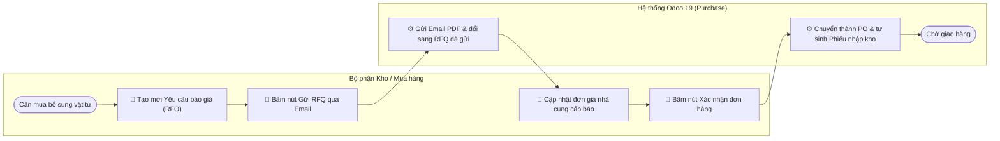

*Hình 3.59: Sơ đồ BPMN quy trình Mua hàng tiếp tế vật tư (6 Task, 0 Gateway)*

### 3.11.2. Đặc tả quy trình và Thư viện dữ liệu

#### 3.11.2.1. Đặc tả các bước của quy trình

**Bảng 3.21: Đặc tả các bước quy trình Mua hàng tiếp tế vật tư**

| STT | Tác nhân | Loại Task BPMN | Tên hộp trên BPMN | Mô tả xử lý trên Odoo 19 |
| :-: | :--- | :---: | :--- | :--- |
| 1 | Bộ phận Kho / Mua hàng | `User Task` | Tạo mới Yêu cầu báo giá (`RFQ`) | Vào `Mua hàng ➔ Yêu cầu báo giá ➔ Mới`, chọn Nhà cung cấp, kho nhận hàng chi nhánh và danh sách mặt hàng cần mua. |
| 2 | Bộ phận Kho / Mua hàng | `User Task` | Bấm nút Gửi RFQ qua Email | Nhấn **Gửi RFQ** và bấm xác nhận gửi trên hộp thoại soạn thảo email. |
| 3 | Hệ thống Odoo 19 | `Service Task` | Gửi Email PDF & đổi sang RFQ đã gửi | Gửi file báo giá `P000...pdf` cho nhà cung cấp và chuyển trạng thái sang `RFQ đã gửi`. |
| 4 | Bộ phận Kho / Mua hàng | `User Task` | Cập nhật đơn giá nhà cung cấp báo | Điền đơn giá mua thực tế, thuế suất và ngày giao hàng dự kiến lên các dòng sản phẩm. |
| 5 | Bộ phận Kho / Mua hàng | `User Task` | Bấm nút Xác nhận đơn hàng | Nhấn **Xác nhận đơn hàng** (`button_confirm`). |
| 6 | Hệ thống Odoo 19 | `Service Task` | Chuyển thành PO & tự sinh Phiếu nhập kho | Chuyển chứng từ sang `Đơn mua hàng` (`purchase`) và tự động sinh phiếu chờ nhận `WH/IN/...` bên phân hệ Tồn kho. |

#### 3.11.2.2. Đặc tả thư viện dữ liệu

**Bảng 3.22: Đặc tả dữ liệu Đơn mua hàng (`purchase.order`)**

| STT | Tên trường giao diện | Tên kỹ thuật | Kiểu dữ liệu | Ý nghĩa & Quy tắc nghiệp vụ |
| :-: | :--- | :--- | :--- | :--- |
| 1 | Mã đơn mua | `name` | `Char` | Mã chứng từ tự sinh theo sequence (`P00010`), chỉ đọc. |
| 2 | Nhà cung cấp | `partner_id` | `Many2one` | Đối tác cung cấp vật tư, đồ vải, nước giải khát cho khách sạn. |
| 3 | Ngày nhận dự kiến & Giao đến | `date_planned`, `picking_type_id` | `Datetime`, `Many2one` | Thời gian hẹn giao và kho chi nhánh tiếp nhận (*Gia Lai* / *Vũng Tàu*). |
| 4 | Chi tiết dòng mua | `order_line` | `One2many` | Sản phẩm, SL đặt (`product_qty`), SL đã nhận (`qty_received`), đơn giá và thuế. |
| 5 | Trạng thái | `state` | `Selection` | `RFQ`, `RFQ đã gửi`, `Đơn mua hàng`, `Đã hủy`. |

*[Hình 3.60: Giao diện Yêu cầu báo giá và Đơn mua hàng PO trên Odoo 19]*

### 3.11.3. Minh họa trên phần mềm Odoo và Xử lý ngoại lệ

#### 3.11.3.1. Các bước thực thi nghiệp vụ chuẩn
- **Bước 1:** Tạo phiếu `RFQ` chọn nhà cung cấp và mặt hàng vật tư cần mua. *(Hình 3.61)*
- **Bước 2:** Bấm **Gửi RFQ** gửi file PDF qua email. *(Hình 3.62)*
- **Bước 3:** Cập nhật đơn giá và bấm **Xác nhận đơn hàng** $\rightarrow$ Xuất hiện Smart Button `Phiếu nhập kho (1)`. *(Hình 3.63)*

#### 3.11.3.2. Xử lý các tình huống ngoại lệ
- **Hủy báo giá (`Hủy`):** Khi nhà cung cấp hết hàng hoặc báo giá cao hơn trần chi phí, nhân viên bấm nút **Hủy** trên `RFQ` để đóng phiếu không phát sinh giao dịch kho. *(Hình 3.64)*

---

## 3.12. Quy trình Nhập kho vật tư

Quy trình này kiểm nhận vật tư giao đến kho khách sạn trên chứng từ `Phiếu nhập kho (WH/IN)` sinh tự động từ Đơn mua hàng (`PO`).

### 3.12.1. Sơ đồ BPMN

- **Số làn:** 2 làn (`Bộ phận Kho`, `Hệ thống Odoo 19`).
- **Quy mô:** 5 hộp Task + 1 Gateway.

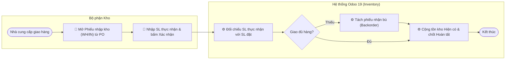

*Hình 3.65: Sơ đồ BPMN quy trình Nhập kho vật tư (5 Task, 1 Gateway)*

### 3.12.2. Đặc tả quy trình và Thư viện dữ liệu

#### 3.12.2.1. Đặc tả các bước của quy trình

**Bảng 3.23: Đặc tả các bước quy trình Nhập kho vật tư**

| STT | Tác nhân | Loại Task BPMN | Tên hộp trên BPMN | Mô tả xử lý trên Odoo 19 |
| :-: | :--- | :---: | :--- | :--- |
| 1 | Bộ phận Kho | `User Task` | Mở Phiếu nhập kho (`WH/IN`) từ PO | Vào `Tồn kho ➔ Phiếu nhập kho`, mở phiếu ở trạng thái `Sẵn sàng` khớp mã `Chứng từ gốc` (`PO`). |
| 2 | Bộ phận Kho | `User Task` | Nhập SL thực nhận & bấm Xác nhận | Điền số lượng kiểm đếm đạt chuẩn vào cột `Số lượng` và nhấn nút **Xác nhận** (`button_validate`). |
| 3 | Hệ thống Odoo 19 | `Service & Gateway` | Đối chiếu SL thực nhận với SL đặt | So sánh `Số lượng` thực nhận với `Nhu cầu`. Nếu nhỏ hơn $\rightarrow$ bước 4; nếu đủ $\rightarrow$ bước 5. |
| 4 | Hệ thống Odoo 19 | `Service Task` | Tách phiếu nhận bù (`Backorder`) | Tự động sinh 1 phiếu `WH/IN` mới ở trạng thái `Sẵn sàng` cho phần hàng nhà cung cấp chưa giao đủ. |
| 5 | Hệ thống Odoo 19 | `Service Task` | Cộng tồn kho `Hiện có` & chốt `Hoàn tất` | Chuyển phiếu sang `Hoàn tất`, cộng tăng tồn kho chi nhánh và đồng bộ cột `Đã nhận` trên PO. |

#### 3.12.2.2. Đặc tả thư viện dữ liệu

**Bảng 3.24: Đặc tả dữ liệu Phiếu nhập kho (`stock.picking`) và Dòng chi tiết (`stock.move`)**

| STT | Mô hình dữ liệu | Tên trường giao diện | Tên kỹ thuật | Ý nghĩa & Quy tắc nghiệp vụ |
| :-: | :--- | :--- | :--- | :--- |
| 1 | `stock.picking` | Tham chiếu & Chứng từ gốc | `name`, `origin` | Mã phiếu nhập (`WH/IN/00001`) và mã `PO` gốc tham chiếu. |
| 2 | `stock.picking` | Vị trí đích & Trạng thái | `location_dest_id`, `state` | Kho chi nhánh lưu trữ và tiến trình (`Nháp`, `Sẵn sàng`, `Hoàn tất`). |
| 3 | `stock.move` | Sản phẩm, Nhu cầu & Số lượng | `product_id`, `product_uom_qty`, `quantity` | Vật tư nhập, số lượng đặt trên PO và số lượng thực nhận vào kho. |

*[Hình 3.66: Giao diện Phiếu nhập kho WH/IN hoàn tất trên Odoo 19]*

### 3.12.3. Minh họa trên phần mềm Odoo và Xử lý ngoại lệ

#### 3.12.3.1. Các bước thực thi nghiệp vụ chuẩn
- **Bước 1:** Mở `WH/IN/00001` từ danh sách `Phiếu nhập kho`. *(Hình 3.67)*
- **Bước 2:** Nhập số lượng thực nhận và bấm **Xác nhận** $\rightarrow$ Phiếu chuyển sang `Hoàn tất`. *(Hình 3.68)*

#### 3.12.3.2. Xử lý các tình huống ngoại lệ
- **a. Giao thiếu hàng (`Backorder`):** Nhập số thực nhận nhỏ hơn nhu cầu và chọn **Tạo phần đọng lại** để tách phiếu chờ giao bù. *(Hình 3.69)*
- **b. Xuất trả hàng lỗi (`Trả hàng - Return`):** Bấm nút **Trả hàng** trên phiếu `WH/IN` vừa nhập để tạo lệnh xuất trả hàng lỗi cho nhà cung cấp. *(Hình 3.70)*

---

## 3.13. Quy trình Kiểm kê kho vật tư

Quy trình này đối soát định kỳ tồn kho vật lý tại từng chi nhánh với tồn kho lý thuyết trên Odoo 19 để cân bằng số liệu.

### 3.13.1. Sơ đồ BPMN

- **Số làn:** 2 làn (`Bộ phận Kho`, `Hệ thống Odoo 19`).
- **Quy mô:** 6 hộp Task thẳng tuyến tính, **0 Gateway**.

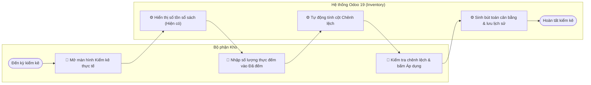

*Hình 3.71: Sơ đồ BPMN quy trình Kiểm kê kho vật tư (6 Task, 0 Gateway)*

### 3.13.2. Đặc tả quy trình và Thư viện dữ liệu

#### 3.13.2.1. Đặc tả các bước của quy trình

**Bảng 3.25: Đặc tả các bước quy trình Kiểm kê kho vật tư**

| STT | Tác nhân | Loại Task BPMN | Tên hộp trên BPMN | Mô tả xử lý trên Odoo 19 |
| :-: | :--- | :---: | :--- | :--- |
| 1 | Bộ phận Kho | `User Task` | Mở màn hình Kiểm kê thực tế | Truy cập `Tồn kho ➔ Hoạt động ➔ Kiểm kê thực tế`, lọc kho chi nhánh cần kiểm kê. |
| 2 | Hệ thống Odoo 19 | `Service Task` | Hiển thị số tồn sổ sách (`Hiện có`) | Hiển thị số lượng tồn lý thuyết hiện tại trên phần mềm. |
| 3 | Bộ phận Kho | `User Task` | Nhập số lượng thực đếm vào `Đã đếm` | Điền số lượng kiểm đếm thực tế tại kho vào cột `Đã đếm`. |
| 4 | Hệ thống Odoo 19 | `Service Task` | Tự động tính cột `Chênh lệch` | Tính `Chênh lệch = Đã đếm - Hiện có`. |
| 5 | Bộ phận Kho | `User Task` | Kiểm tra chênh lệch & bấm Áp dụng | Thủ kho xác nhận số liệu và nhấn nút **Áp dụng** (`Apply`). |
| 6 | Hệ thống Odoo 19 | `Service Task` | Sinh bút toán cân bằng & lưu lịch sử | Cập nhật lại cột `Hiện có = Đã đếm` và ghi vết lịch sử dịch chuyển kho. |

#### 3.13.2.2. Đặc tả thư viện dữ liệu

**Bảng 3.26: Đặc tả dữ liệu Điều chỉnh tồn kho (`stock.quant`)**

| STT | Tên trường giao diện | Tên kỹ thuật | Kiểu dữ liệu | Ý nghĩa & Quy tắc nghiệp vụ |
| :-: | :--- | :--- | :--- | :--- |
| 1 | Vị trí & Sản phẩm | `location_id`, `product_id` | `Many2one` | Kho chi nhánh và mặt hàng vật tư được kiểm kê. |
| 2 | Hiện có / Đã đếm / Chênh lệch | `quantity`, `inventory_quantity`, `inventory_diff_quantity` | `Float` | Tồn lý thuyết, tồn thực đếm và mức chênh lệch tự động tính. |
| 3 | Người dùng & Ngày lên lịch | `user_id`, `inventory_date` | `Many2one`, `Date` | Nhân sự chịu trách nhiệm đếm và ngày kiểm kê định kỳ. |

*[Hình 3.72: Giao diện màn hình Kiểm kê thực tế trên Odoo 19]*

### 3.13.3. Minh họa trên phần mềm Odoo và Xử lý ngoại lệ

#### 3.13.3.1. Các bước thực thi nghiệp vụ chuẩn
- **Bước 1:** Mở `Kiểm kê thực tế`, chọn mặt hàng cần đối soát. *(Hình 3.73)*
- **Bước 2:** Nhập cột `Đã đếm` và nhấn **Áp dụng** để cập nhật lại tồn kho `Hiện có`. *(Hình 3.74)*

#### 3.13.3.2. Xử lý các tình huống ngoại lệ
- **Xuất hủy hàng hỏng, hết hạn bằng Lệnh Loại bỏ (`Scrap`):** Vào `Tồn kho ➔ Hoạt động ➔ Loại bỏ`, tạo phiếu `SP/00001` kèm thẻ lý do hỏng và bấm **Xác thực** để chuyển hàng lỗi sang kho ảo `Scrap` (tránh gộp mù mờ vào chênh lệch kiểm kê). *(Hình 3.75)*

---

## 3.14. Quy trình Thanh toán công nợ nhà cung cấp

Quy trình này kiểm soát chiều chi tiền ra (Accounts Payable) của **Bộ phận Tài chính – Kế toán**: lập `Hóa đơn nhà cung cấp (BILL/...)` từ các đơn mua vật tư đã nhập kho, theo dõi hạn nợ và thực hiện chi trả cho đối tác cung ứng.

### 3.14.1. Sơ đồ BPMN

- **Số làn:** 2 làn (`Bộ phận Kế toán`, `Hệ thống Odoo 19`).
- **Quy mô:** 6 hộp Task + 1 Gateway.

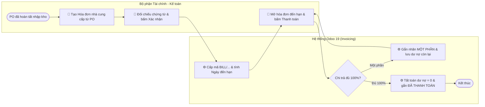

*Hình 3.76: Sơ đồ BPMN quy trình Thanh toán công nợ nhà cung cấp (6 Task, 1 Gateway)*

### 3.14.2. Đặc tả quy trình và Thư viện dữ liệu

#### 3.14.2.1. Đặc tả các bước của quy trình

**Bảng 3.27: Đặc tả các bước quy trình Thanh toán công nợ nhà cung cấp**

| STT | Tác nhân | Loại Task BPMN | Tên hộp trên BPMN | Mô tả xử lý trên Odoo 19 |
| :-: | :--- | :---: | :--- | :--- |
| 1 | Bộ phận Kế toán | `User Task` | Tạo Hóa đơn nhà cung cấp từ PO | Mở Đơn mua hàng `PO` đã nhận hàng và nhấn nút **Tạo hóa đơn** (`Create Bill`). |
| 2 | Bộ phận Kế toán | `User Task` | Đối chiếu chứng từ & bấm Xác nhận | Đối chiếu 3 chiều (*PO – Phiếu nhập WH/IN – Hóa đơn gốc NCC*), nhập `Ngày hóa đơn` và bấm **Xác nhận**. |
| 3 | Hệ thống Odoo 19 | `Service Task` | Cấp mã `BILL/...` & tính Ngày đến hạn | Cấp số chứng từ `BILL/2026/...`, ghi sổ công nợ phải trả và tự động theo dõi cảnh báo hạn thanh toán. |
| 4 | Bộ phận Kế toán | `User Task` | Mở hóa đơn đến hạn & bấm Thanh toán | Nhấn nút **Thanh toán**, chọn `Sổ nhật ký` (`Ngân hàng`/`Tiền mặt`), nhập số tiền chi và bấm **Tạo thanh toán**. |
| 5 | Hệ thống Odoo 19 | `Gateway & Service` | Chi trả đủ 100%? $\rightarrow$ Cập nhật dư nợ | Nếu trả một phần $\rightarrow$ gắn nhãn **MỘT PHẦN** và giữ lại số dư nợ; nếu trả đủ $\rightarrow$ dư nợ về `0 ₫` và gắn nhãn **ĐÃ THANH TOÁN**. |

#### 3.14.2.2. Đặc tả thư viện dữ liệu

**Bảng 3.28: Đặc tả dữ liệu Hóa đơn nhà cung cấp (`account.move` – `in_invoice`) và Phiếu thanh toán (`account.payment`)**

| STT | Mô hình dữ liệu | Tên trường giao diện | Tên kỹ thuật | Ý nghĩa & Quy tắc nghiệp vụ |
| :-: | :--- | :--- | :--- | :--- |
| 1 | `account.move` | Mã hóa đơn mua & Tham chiếu | `name`, `ref` | Số chứng từ nội bộ (`BILL/2026/...`) và số hóa đơn gốc của nhà cung cấp. |
| 2 | `account.move` | Nhà cung cấp | `partner_id` | Đơn vị cung ứng vật tư buồng phòng, đồ uống Minibar, dịch vụ giặt là. |
| 3 | `account.move` | Ngày hóa đơn & Ngày đến hạn | `invoice_date`, `invoice_date_due` | Căn cứ tính hạn nợ tự động theo Điều khoản thanh toán. |
| 4 | `account.move` | Tổng & Số tiền phải trả | `amount_total`, `amount_residual` | Tổng giá trị công nợ và số dư còn phải chi trả. |
| 5 | `account.payment` | Sổ nhật ký & Số tiền chi | `journal_id`, `amount` | Tài khoản ngân hàng/tiền mặt xuất quỹ và số tiền thanh toán từng đợt. |

*[Hình 3.77: Giao diện Hóa đơn nhà cung cấp BILL/... và cửa sổ Thanh toán công nợ trên Odoo 19]*

### 3.14.3. Minh họa trên phần mềm Odoo và Xử lý ngoại lệ

#### 3.14.3.1. Các bước thực thi nghiệp vụ chuẩn
- **Bước 1:** Vào `Hóa đơn ➔ Nhà cung cấp ➔ Hóa đơn`, xác nhận vào sổ chứng từ `BILL/2026/...`. *(Hình 3.78)*
- **Bước 2:** Nhấn **Thanh toán** $\rightarrow$ chọn sổ `Ngân hàng` $\rightarrow$ nhấn **Tạo thanh toán** để tất toán hóa đơn. *(Hình 3.79)*

#### 3.14.3.2. Xử lý các tình huống ngoại lệ
- **a. Thanh toán công nợ từng phần (`Một phần`):** Nhập số tiền chi đợt 1 nhỏ hơn tổng hóa đơn $\rightarrow$ Hóa đơn gắn nhãn **MỘT PHẦN** và lưu số dư còn lại để theo dõi trả tiếp đợt 2. *(Hình 3.80)*
- **b. Đối trừ công nợ khi xuất trả hàng lỗi (`Giấy báo có NCC`):** Nhấn **Giấy báo có** trên hóa đơn `BILL/...`, nhập lý do trả hàng lỗi và xác nhận chứng từ `RBILL/...` để giảm trừ trực tiếp số tiền phải trả. *(Hình 3.81)*
- **c. Điều chỉnh hóa đơn nhập sai (`Đặt lại thành nháp`):** Nhấn **Đặt lại thành nháp** trên hóa đơn chưa thanh toán để sửa lại thông tin sai sót rồi xác nhận lại. *(Hình 3.82)*

---

## 3.15. Quy trình Báo cáo quản trị đa chi nhánh

Quy trình cuối cùng mô tả cách module `m_hotel_report` tự động hợp nhất dữ liệu vận hành phòng và doanh thu của **Khách Sạn M (Cơ sở 1 - Gia Lai)** và **M-Hotel Vũng Tàu Resort (Cơ sở 2 - Vũng Tàu)** qua khung nhìn SQL để Ban Giám đốc phân tích hiệu suất toàn chuỗi.

### 3.15.1. Sơ đồ BPMN

- **Số làn:** 2 làn (`Hệ thống Odoo 19`, `Ban Giám đốc`).
- **Quy mô:** 4 hộp Task thẳng tuyến tính, **0 Gateway**.

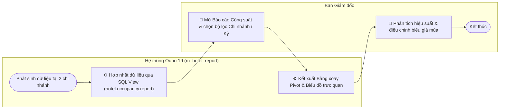

*Hình 3.83: Sơ đồ BPMN quy trình Báo cáo quản trị đa chi nhánh (4 Task, 0 Gateway)*

### 3.15.2. Đặc tả quy trình và Thư viện dữ liệu

#### 3.15.2.1. Đặc tả các bước của quy trình

**Bảng 3.29: Đặc tả các bước quy trình Báo cáo quản trị đa chi nhánh**

| STT | Tác nhân | Loại Task BPMN | Tên hộp trên BPMN | Mô tả xử lý trên Odoo 19 |
| :-: | :--- | :---: | :--- | :--- |
| 1 | Hệ thống Odoo 19 | `Service Task` | Hợp nhất dữ liệu qua SQL View | View cơ sở dữ liệu `hotel_occupancy_report` tự động truy vấn trực tiếp các đơn hợp lệ (`state NOT IN ('draft', 'cancel')`) từ cả 2 công ty con. |
| 2 | Ban Giám đốc | `User Task` | Mở Báo cáo Công suất & chọn bộ lọc | Bật chọn cả 2 chi nhánh trên góc phải màn hình, mở `Báo Cáo & Phân Tích ➔ Công Suất & Doanh Thu Phòng` và chọn chiều nhóm (`Chi nhánh`, `Hạng phòng`, `Tháng`). |
| 3 | Hệ thống Odoo 19 | `Service Task` | Kết xuất Bảng xoay Pivot & Biểu đồ | Tính toán tức thời `Doanh thu phòng`, `Doanh thu dịch vụ`, `Số đêm đã bán`, `Số giờ đã bán` và `Lượt đặt phòng` trên `Pivot` / `Graph`. |
| 4 | Ban Giám đốc | `User Task` | Phân tích hiệu suất & điều chỉnh giá mùa | Đối chiếu tỷ lệ khai thác giữa *Gia Lai* và *Vũng Tàu* để ra quyết định điều chỉnh `Biểu Giá Theo Mùa & Dịp Lễ`. |

#### 3.15.2.2. Đặc tả thư viện dữ liệu

**Bảng 3.30: Đặc tả dữ liệu Khung nhìn Báo cáo quản trị (`hotel.occupancy.report`)**

| STT | Tên trường giao diện | Tên kỹ thuật | Kiểu dữ liệu | Ý nghĩa & Quy tắc tổng hợp SQL View |
| :-: | :--- | :--- | :--- | :--- |
| 1 | Ngày hạch toán | `date` | `Date` | Ngày lưu trú trích xuất tự động `COALESCE(check_in::date, hour_date, create_date::date)`. |
| 2 | Cơ sở / Chi nhánh | `company_id` | `Many2one` | Chiều phân tích so sánh *Cơ sở 1 - Gia Lai* và *Cơ sở 2 - Vũng Tàu*. |
| 3 | Hạng phòng & Phòng | `room_type_id`, `room_id` | `Many2one` | Chiều phân tích hiệu suất từng hạng phòng (`DON`, `DOI`, `BA`, `TAPTHE`, `GD`, `APMAI`). |
| 4 | Hình thức thuê | `rent_type` | `Selection` | Tách biệt hiệu quả khai thác `Thuê theo đêm` và `Thuê theo giờ`. |
| 5 | Số đêm / Số giờ / Lượt đặt | `nights_count`, `hours_duration`, `booking_count` | `Integer` | Các chỉ số đo lường (`Measure`) đánh giá công suất sử dụng buồng phòng. |
| 6 | Doanh thu phòng / Dịch vụ / Tổng | `amount_room`, `amount_services`, `amount_total` | `Float` | Bóc tách doanh thu phòng thuần, doanh thu dịch vụ Folio và tổng doanh thu (VNĐ). |

*[Hình 3.84: Giao diện Bảng xoay Pivot và Biểu đồ phân tích công suất – doanh thu đa chi nhánh]*

### 3.15.3. Minh họa trên phần mềm Odoo và Xử lý ngoại lệ

#### 3.15.3.1. Các bước thực thi nghiệp vụ chuẩn
- **Bước 1:** Tích chọn đồng thời cả 2 chi nhánh (*Gia Lai* & *Vũng Tàu*) trên thanh Multi-Company. *(Hình 3.85)*
- **Bước 2:** Xem chế độ **Bảng xoay (Pivot)** so sánh doanh thu và số đêm đã bán theo từng Hạng phòng và Chi nhánh. *(Hình 3.86)*
- **Bước 3:** Chuyển sang chế độ **Biểu đồ (Graph)** để theo dõi trực quan tương quan doanh thu giữa hai cơ sở. *(Hình 3.87)*

#### 3.15.3.2. Xử lý các tình huống ngoại lệ
- **Giới hạn phạm vi báo cáo theo quyền chi nhánh:** Khi tài khoản nhân sự chỉ được cấp quyền tại 1 cơ sở duy nhất (VD: *Cơ sở 1 - Gia Lai*), cơ chế Multi-Company tự động lọc SQL View chỉ trả về số liệu của Gia Lai, bảo mật tuyệt đối doanh thu của cơ sở Vũng Tàu. *(Hình 3.88)*
