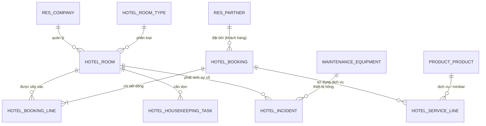

# KẾ HOẠCH CHI TIẾT TRIỂN KHAI HỆ THỐNG ERP QUẢN LÝ VẬN HÀNH KHÁCH SẠN M-HOTEL TRÊN ODOO TỪ A ĐẾN Z

> **Dự án**: Hệ thống ERP Quản lý Vận hành Khách sạn / M-Hotel  
> **Môn học**: IS336 – Hoạch định Nguồn lực Doanh nghiệp (Lớp: IS336.R11.1)  
> **Giảng viên hướng dẫn (Sponsor)**: ThS. Huỳnh Đức Huy  
> **Đơn vị thực hiện**: Nhóm 12  
> **Project Manager**: Bùi Minh Triết (MSSV: 24521845)  
> **Thời gian thực hiện**: 12/10/2026 – 19/12/2026 (10 tuần)  
> **Phiên bản kế hoạch**: v2.0 (Master Execution Plan)

---

## MỤC LỤC
1. [TỔNG QUAN DỰ ÁN & MÔ HÌNH VẬN HÀNH THỰC TẾ](#1-tổng-quan-dự-án--mô-hình-vận-hành-thực-tế)
2. [ĐÁNH GIÁ TÍNH KHẢ DỤNG CHO KHÁCH HÀNG VÀ CHỦ KHÁCH SẠN](#2-đánh-giá-tính-khả-dụng-cho-khách-hàng-và-chủ-khách-sạn)
3. [MA TRẬN PHÂN QUYỀN NGƯỜI DÙNG CHI TIẾT (SECURITY & ACCESS RIGHTS)](#3-ma-trận-phân-quyền-người-dùng-chi-tiết-security--access-rights)
4. [BỘ DỮ LIỆU GIẢ LẬP KHỔNG LỒ (20 – 50 BẢN GHI MỖI LOẠI)](#4-bộ-dữ-liệu-giả-lập-khổng-lồ-20--50-bản-ghi-mỗi-loại)
5. [KIẾN TRÚC GIẢI PHÁP & MÔ HÌNH DỮ LIỆU (ERD)](#5-kiến-trúc-giải-pháp--mô-hình-dữ-liệu-erd)
6. [LỘ TRÌNH 7 MỐC TIẾN ĐỘ CHUẨN CHARTER (M1 – M7)](#6-lộ-trình-7-mốc-tiến-độ-chuẩn-charter-m1--m7)
7. [HƯỚNG DẪN THỰC HIỆN CHI TIẾT TỪ A ĐẾN Z TRÊN ODOO](#7-hướng-dẫn-thực-hiện-chi-tiết-từ-a-đến-z-trên-odoo)
   - [Giai đoạn 1: Khởi tạo Nền tảng, Đa cơ sở (Multi-company) & Tiền tệ VNĐ](#giai-đoạn-1-khởi-tạo-nền-tảng-đa-cơ-sở-multi-company--tiền-tệ-vnđ)
   - [Giai đoạn 2: Quản lý Danh mục Loại phòng & Phòng (Sửa lỗi chính tả Loại phòng)](#giai-đoạn-2-quản-lý-danh-mục-loại-phòng--phòng)
   - [Giai đoạn 3: Phân hệ Đặt phòng (Theo Giờ & Theo Ngày) & Lịch Calendar Trực quan](#giai-đoạn-3-phân-hệ-đặt-phòng-theo-giờ--theo-ngày--lịch-calendar-trực-quan)
   - [Giai đoạn 4: Nghiệp vụ Check-in, Check-out & Dịch vụ phát sinh](#giai-đoạn-4-nghiệp-vụ-check-in-check-out--dịch-vụ-phát-sinh)
   - [Giai đoạn 5: Vận hành Buồng phòng (Housekeeping) & Quản lý Sự vụ (Incident)](#giai-đoạn-5-vận-hành-buồng-phòng-housekeeping--quản-lý-sự-vụ-incident)
   - [Giai đoạn 6: Tích hợp Quản lý Kho Vật tư (Inventory) & Thiết bị (Maintenance)](#giai-đoạn-6-tích-hợp-quản-lý-kho-vật-tư-inventory--thiết-bị-maintenance)
   - [Giai đoạn 7: Phân quyền theo 5 Vai trò & Hệ thống Nhật ký Audit Log](#giai-đoạn-7-phân-quyền-theo-5-vai-trò--hệ-thống-nhật-ký-audit-log)
   - [Giai đoạn 8: Xây dựng Dashboard & Hệ thống Báo cáo Quản trị](#giai-đoạn-8-xây-dựng-dashboard--hệ-thống-báo-cáo-quản-trị)
8. [BỘ 12 TEST CASE NGHIỆM THU (TC01 – TC12)](#8-bộ-12-test-case-nghiệm-thu-tc01--tc12)
9. [HƯỚNG DẪN ĐÓNG GÓI SẢN PHẨM & KỊCH BẢN THUYẾT TRÌNH BẢO VỆ](#9-hướng-dẫn-đóng-gói-sản-phẩm--kịch-bản-thuyết-trình-bảo-vệ)

---

## 1. TỔNG QUAN DỰ ÁN & MÔ HÌNH VẬN HÀNH THỰC TẾ

### 1.1. Hiện trạng (AS-IS) & Nhu cầu cấp thiết
- Khách sạn quy mô vừa và nhỏ vận hành hoàn toàn bằng Excel hoặc sổ sách truyền thống.
- **Rủi ro lớn nhất**: Trùng lịch phòng (double-booking) khi nhiều lễ tân nhận khách cùng lúc; thông tin sai lệch giữa Lễ tân và Buồng phòng (khách check-out nhưng buồng phòng chưa hay biết, phòng chưa dọn nhưng lễ tân đã giao chìa khóa).
- **Vật tư & Minibar thất thoát**: Không kiểm soát được số lượng tiêu hao (khăn, dầu gội, nước ngọt, bia) theo từng lượt khách và theo định mức.
- **Tài sản phòng xuống cấp**: Điều hòa hỏng, tivi mất tín hiệu không có lịch sử ghi nhận xử lý, không xác định được trách nhiệm bảo trì.

### 1.2. Mục tiêu giải pháp TO-BE trên Odoo ERP
Xây dựng một hệ sinh thái ERP hoàn chỉnh cho khách sạn M-Hotel bao gồm:
1. **Front-Desk (Tiền sảnh)**: Đặt phòng trực quan, sơ đồ lịch phòng theo thời gian thực (Calendar View), tự động hóa Check-in / Check-out, xuất hóa đơn VAT / Phiếu thanh toán tiền phòng & dịch vụ bằng **VNĐ**.
2. **Housekeeping (Buồng phòng)**: Chuẩn hóa vòng đời trạng thái phòng:
   $$\text{Trống (Clean)} \longrightarrow \text{Đã đặt (Reserved)} \longrightarrow \text{Đang ở (Occupied)} \longrightarrow \text{Chờ dọn (Dirty)} \longrightarrow \text{Trống (Clean)}$$
3. **Maintenance & Assets (Kỹ thuật & Tài sản)**: Quản lý thiết bị trong phòng, tạo phiếu sự vụ sửa chữa, tự động chuyển phòng sang trạng thái **Đang bảo trì / Ngưng sử dụng (Out of Order)** để chặn đặt phòng.
4. **Inventory (Kho vật tư tiêu hao)**: Quản lý xuất nhập tồn đồ Amenities, Minibar, cảnh báo tự động khi tồn kho dưới mức tối thiểu.
5. **Multi-company (Chuỗi đa chi nhánh)**: Quản lý song song tối thiểu 2 cơ sở:
   - *Cơ sở 1: M-Hotel Chi nhánh Quận 1 (Bến Nghé, Q1, TP.HCM)*
   - *Cơ sở 2: M-Hotel Chi nhánh Thủ Đức (Linh Chiểu, TP. Thủ Đức)*

---

## 2. ĐÁNH GIÁ TÍNH KHẢ DỤNG CHO KHÁCH HÀNG VÀ CHỦ KHÁCH SẠN

### 2.1. Trải nghiệm dành cho Khách hàng (Customer Experience)
Hệ thống hỗ trợ khách hàng trọn vẹn qua 2 kênh:
1. **Kênh trực tuyến (Website Khách sạn & Cổng Portal)**:
   - **Xem & Chọn phòng**: Truy cập trang web `https://edu-m-hotel.odoo.com/shop`, xem ảnh thực tế, tiện ích, giá niêm yết VNĐ của từng hạng phòng (Standard, Deluxe, Family, Suite).
   - **Đặt phòng tự phục vụ (Self-service Booking)**: Điền ngày nhận phòng (Check-in), ngày trả phòng (Check-out), số lượng khách và gửi yêu cầu giữ phòng trực tiếp.
   - **Thanh toán & Đặt cọc**: Hỗ trợ chuyển khoản ngân hàng quét mã QR / tiền mặt / thẻ ngân hàng.
   - **Cổng thông tin cá nhân (Customer Portal `/my`)**: Khách tự tra cứu lịch sử đặt phòng, thời gian lưu trú và tải hóa đơn VAT điện tử (file PDF) bất cứ lúc nào.
2. **Kênh truyền thống (Lễ tân hỗ trợ)**:
   - Khách gọi hotline hoặc đến quầy lễ tân (Walk-in), nhân viên lễ tân mở Odoo tra cứu lịch phòng trống và tạo phiếu đặt phòng ngay lập tức.

### 2.2. Công cụ quản trị dành cho Chủ khách sạn / Ban Giám đốc (Owner & Executive Experience)
Chủ khách sạn sử dụng giao diện quản trị trung tâm Backend (`/odoo`) với các công cụ tối tân:
1. **Bảng điều khiển tức thời (Live Executive Dashboard)**:
   - Nắm bắt doanh thu theo ngày/tháng/năm hoàn toàn bằng **VNĐ**.
   - Theo dõi tỷ lệ lấp đầy phòng (Occupancy Rate) theo thời gian thực để đưa ra chiến lược giá linh hoạt.
2. **Báo cáo đa chiều toàn chuỗi (Multi-branch Analytics)**:
   - Chuyển đổi linh hoạt giữa Cơ sở Quận 1 và Cơ sở Thủ Đức; xem báo cáo doanh thu độc lập hoặc hợp nhất toàn chuỗi.
3. **Kiểm soát thất thoát & Tối ưu chi phí**:
   - Giám sát mức tiêu hao Minibar, vật tư buồng phòng; nhận cảnh báo tự động khi kho hàng dưới mức tồn an toàn.
   - Kiểm tra tình trạng hỏng hóc tài sản và thời gian xử lý sự cố của nhân viên kỹ thuật.

---

## 3. MA TRẬN PHÂN QUYỀN NGƯỜI DÙNG CHI TIẾT (SECURITY & ACCESS RIGHTS)

Odoo áp dụng cơ chế Phân quyền theo Vai trò (RBAC) kết hợp Quy tắc ghi bản ghi (Record Rules) theo từng chi nhánh:

| Nghiệp vụ / Phân hệ | 👑 Chủ / Quản lý (Manager) | 🛎️ Lễ tân (Receptionist) | 🧹 Buồng phòng (Housekeeping) | 🔧 Kỹ thuật (Technician) | 📦 Kho / Mua hàng (Inventory) | 👤 Khách hàng (Portal) |
|---|:---:|:---:|:---:|:---:|:---:|:---:|
| **Xem Dashboard Doanh thu toàn chuỗi** | ✅ Toàn quyền | ❌ Chặn | ❌ Chặn | ❌ Chặn | ❌ Chặn | ❌ Chặn |
| **Cấu hình Bảng giá & Hạng phòng** | ✅ Toàn quyền | 👁️ Chỉ xem | ❌ Chặn | ❌ Chặn | ❌ Chặn | 👁️ Xem trên Web |
| **Tạo & Xác nhận Đặt phòng (Booking)** | ✅ Toàn quyền | ✅ Thao tác chính | ❌ Chặn | ❌ Chặn | ❌ Chặn | ✅ Đặt trên Web |
| **Thực hiện Check-in / Check-out** | ✅ Toàn quyền | ✅ Thao tác chính | ❌ Chặn | ❌ Chặn | ❌ Chặn | ❌ Chặn |
| **Cập nhật Trạng thái Phòng Sạch/Bẩn** | ✅ Toàn quyền | 👁️ Xem phòng trống | ✅ Thao tác chính | 👁️ Chỉ xem | ❌ Chặn | ❌ Chặn |
| **Báo cáo Sự vụ & Khóa phòng bảo trì** | ✅ Phê duyệt | ➕ Tạo yêu cầu | ➕ Báo sự vụ | ✅ Xử lý & Sửa | ❌ Chặn | ❌ Chặn |
| **Quản lý Nhập/Xuất & Kiểm kê Kho** | ✅ Phê duyệt | ❌ Chặn | ➕ Đề xuất cấp vật tư | ➕ Đề xuất phụ tùng | ✅ Thao tác chính | ❌ Chặn |
| **Xuất Hóa đơn tài chính VNĐ** | ✅ Toàn quyền | ✅ In phiếu tính tiền | ❌ Chặn | ❌ Chặn | ❌ Chặn | 📥 Tải hóa đơn của mình |
| **Nhật ký Audit Log (Chatter)** | 👁️ Đầy đủ | ➕ Ghi chú đơn | ➕ Ghi chú dọn phòng | ➕ Báo cáo sửa chữa | ➕ Ghi chú kho | ❌ Không thấy log nội bộ |

---

## 4. BỘ DỮ LIỆU GIẢ LẬP KHỔNG LỒ (20 – 50 BẢN GHI MỖI LOẠI)

Để phục vụ kiểm thử thực tế và tạo biểu đồ báo cáo ấn tượng, hệ thống đã chuẩn bị sẵn 5 tệp dữ liệu CSV chuẩn hóa lưu tại `d:\HK5\Hoach_Dinh\Đồ_Án\`:

1. **`import_30_phong.csv` (30 Phòng Khách Sạn)**:
   - Gồm 5 tầng (Tầng 1 đến Tầng 5), phòng từ `101` đến `506`.
   - Phân bổ đủ 4 hạng phòng: Standard (500.000₫), Deluxe (800.000₫), Family (1.200.000₫), Suite (3.200.000₫).
   - Trạng thái vệ sinh thực tế: Sạch, Chờ dọn, Đang dọn, Đang kiểm tra.
   - Phân bổ ở cả 2 cơ sở: 18 phòng Chi nhánh Quận 1 và 12 phòng Chi nhánh Thủ Đức.
2. **`import_40_khach_hang_mhotel.csv` (40 Khách Hàng)**:
   - 40 hồ sơ khách hàng đầy đủ Họ tên, Số điện thoại (đầu số 09x), Email, Địa chỉ thường trú (TP.HCM, Hà Nội, Đà Nẵng, Cần Thơ, Nha Trang...).
3. **`import_35_booking_mau.csv` (35 Đơn Đặt Phòng Mẫu)**:
   - Mã đơn: từ `BK0001` đến `BK0035`.
   - Khoảng thời gian lưu trú trong tháng 10/2026.
   - Đầy đủ các trạng thái nghiệp vụ: `confirmed` (Đã xác nhận), `checked_in` (Đang ở), `checked_out` (Đã trả phòng), `draft` (Nháp), `cancelled` (Hủy phòng).
   - Doanh thu đa dạng từ 500.000 VNĐ đến 12.800.000 VNĐ.
4. **`import_25_su_vu_phong.csv` (25 Phiếu Sự Vụ & Bảo Trì)**:
   - Mã sự vụ từ `INC001` đến `INC025`.
   - Các lỗi thực tế: Máy lạnh chảy nước, Tivi mất tín hiệu, Vòi sen rỉ nước, Khóa thẻ từ hỏng, Bồn cầu tắc...
   - Mức độ ưu tiên: Thấp, Trung bình, Khẩn cấp gắn với Kỹ thuật viên phụ trách.
5. **`import_30_vat_tu_kho.csv` (30 Mặt Hàng Tồn Kho Vật Tư)**:
   - Chia thành 5 nhóm: Vật tư vải (Khăn tắm, ga giường), Amenities (Bàn chải, dầu gội, dao cạo), Minibar (Bia Heineken, Coca, Nước suối), Miễn phí (Trà, Cafe G7), Tiêu hao & Hóa chất.
   - Đầy đủ số lượng Tồn kho thực tế, Định mức tồn tối thiểu (Min) và Giá vốn nhập hàng.

---

## 5. KIẾN TRÚC GIẢI PHÁP & MÔ HÌNH DỮ LIỆU (ERD)

### 2.1. Hai phương án triển khai bổ trợ nhau
| Tiêu chí | Cách 1: Odoo SaaS Cloud + Studio (Demo Live) | Cách 2: Custom Module `m_hotel` (Nộp mã nguồn) |
|---|---|---|
| **Mục đích** | Demo trực tiếp cho giảng viên trên web không sợ rớt mạng/lỗi server local | Đáp ứng 100% yêu cầu kỹ thuật chấm điểm đồ án (Python ORM, XML, GitHub) |
| **Nền tảng** | `https://edu-m-hotel.odoo.com/` | Odoo 17 Community (Docker + PostgreSQL) |
| **Công cụ** | Odoo Studio, Website Builder, Automated Actions | Python 3.10+, PostgreSQL 15, QWeb, OWL |
| **Mã nguồn** | Export Odoo Studio customization | Thư mục module `m_hotel/` đẩy lên GitHub |

### 2.2. Mô hình Thực thể - Quan hệ (Data Model ERD)

---

## 3. LỘ TRÌNH 7 MỐC TIẾN ĐỘ CHUẨN CHARTER (M1 – M7)

| Mốc | Tên mốc | Thời gian | Nội dung công việc chính | Sản phẩm đầu ra |
|:---:|---|:---:|---|---|
| **M1** | **Khảo sát & Khởi động** | 12/10 – 18/10/2026 | Khảo sát quy trình AS-IS/TO-BE, hoàn thiện Project Charter, phân công 5 thành viên nhóm. | `Project_Charter_M-Hotel.docx`, biên bản họp M1. |
| **M2** | **Phân tích & Thiết kế** | 19/10 – 01/11/2026 | Thiết kế BPMN quy trình, ERD chi tiết, UI Wireframe, cài đặt môi trường Odoo & thiết lập Studio/Docker. | Sơ đồ BPMN, ERD, cấu trúc thư mục module, setup database. |
| **M3** | **Danh mục & Booking** | 02/11 – 15/11/2026 | Danh mục Loại phòng, Danh sách phòng, Phiếu đặt phòng (Booking), Lịch Calendar, cơ chế chặn trùng lịch. | Model `Loại phòng`, `Phòng`, `Đặt phòng`, Calendar View. |
| **M4** | **Vận hành & Sự vụ** | 16/11 – 29/11/2026 | Nghiệp vụ Check-in/Check-out, Dịch vụ minibar/giặt ủi, Task buồng phòng, Sự vụ bảo trì thiết bị. | Nút Check-in/out, module sự vụ, buồng phòng, liên kết Maintenance. |
| **M5** | **Kho, Báo cáo & Đa cơ sở** | 30/11 – 06/12/2026 | Tồn kho vật tư (Inventory), phân quyền 5 vai trò, Audit log, Đa cơ sở (Multi-company), Dashboard KPI. | Cấu hình 2 chi nhánh, phân quyền Groups, Dashboard Graph/Pivot. |
| **M6** | **Kiểm thử & Triển khai** | 07/12 – 13/12/2026 | Chạy trọn vẹn 12 Test Cases (TC01 – TC12), fix bug, deploy URL trực tuyến và GitHub repo. | Bảng kết quả kiểm thử 12 Test Cases, URL demo hoạt động. |
| **M7** | **Nghiệm thu & Báo cáo** | 14/12 – 19/12/2026 | Hoàn thiện Báo cáo Word (DOCX), slide thuyết trình PPTX, quay video kịch bản demo vận hành. | Báo cáo hoàn chỉnh, Slide bảo vệ, Video demo. |

---

## 4. HƯỚNG DẪN THỰC HIỆN CHI TIẾT TỪ A ĐẾN Z TRÊN ODOO

### Giai đoạn 1: Khởi tạo Nền tảng, Đa cơ sở (Multi-company) & Tiền tệ VNĐ

1. **Thiết lập Tiền tệ chính là VNĐ**:
   - Vào **Kế toán (Invoicing) ➔ Cấu hình ➔ Tiền tệ**.
   - Bật hoạt động tiền tệ `VND` (Ký hiệu: `₫` hoặc `VND`). Đặt tỉ giá quy đổi = 1.0 (Tiền tệ cơ sở).
   - Tắt tiền tệ `USD` để tránh nhầm lẫn trong đơn giá phòng và hóa đơn.
2. **Cấu hình Đa cơ sở (Multi-company)**:
   - Vào **Cài đặt ➔ Người dùng & Công ty ➔ Công ty**.
   - Tạo 2 pháp nhân chi nhánh:
     - `M-Hotel Chi nhánh 1 (Quận 1)` - Địa chỉ: 12 Lê Duẩn, Bến Nghé, Quận 1, TP.HCM.
     - `M-Hotel Chi nhánh 2 (Thủ Đức)` - Địa chỉ: 45 Võ Văn Ngân, Linh Chiểu, TP. Thủ Đức.
   - Phân quyền cho tài khoản Quản lý được phép chuyển đổi linh hoạt giữa 2 chi nhánh trên thanh menu góc trên bên phải.

---

### Giai đoạn 2: Quản lý Danh mục Loại phòng & Phòng

1. **Chuẩn hóa Menu & Model `Loại phòng` (Hotel Room Type)**:
   - Sửa lỗi chính tả menu: Đổi từ `LoLoai phong` thành chuẩn **`Loại phòng`**.
   - Tên kỹ thuật model: `x_hotel_room_type`
   - Các trường thuộc tính:
     - `x_name` (Tên loại phòng - Char, Bắt buộc): Tiêu đề bản ghi.
     - `x_code` (Mã loại phòng - Char, Bắt buộc): VD: `STD`, `DLX`, `FAM`, `SUI`.
     - `x_capacity` (Sức chứa tiêu chuẩn - Integer): Số khách tối đa.
     - `x_price_per_night` (Đơn giá theo đêm - Monetary VNĐ).
     - `x_price_first_hours` (Đơn giá 2 giờ đầu - Monetary VNĐ - Dành cho thuê theo giờ).
     - `x_price_next_hour` (Đơn giá mỗi giờ tiếp theo - Monetary VNĐ).
     - `x_description` (Mô tả tiện nghi - HTML / Text).
   - **Bảng giá mẫu áp dụng cả Theo Giờ & Theo Đêm**:
     - `STD` | Standard | 2 người | Giá đêm: 500.000₫ | 2 giờ đầu: 150.000₫ | Giờ tiếp: 50.000₫
     - `DLX` | Deluxe Ocean View | 2 người | Giá đêm: 800.000₫ | 2 giờ đầu: 250.000₫ | Giờ tiếp: 80.000₫
     - `FAM` | Family Căn hộ | 4 người | Giá đêm: 1.200.000₫ | 2 giờ đầu: 400.000₫ | Giờ tiếp: 120.000₫
     - `SUI` | Suite Tổng Thống | 2 người | Giá đêm: 3.200.000₫ | 2 giờ đầu: 1.000.000₫ | Giờ tiếp: 300.000₫

2. **Tạo Model `Danh sách phòng` (Hotel Room)**:
   - Tên kỹ thuật: `x_hotel_room`
   - Các trường thuộc tính:
     - `x_name` (Số phòng - Char, Bắt buộc): VD: `101`, `102`, `201`, `202`, `301`...
     - `x_floor` (Tầng - Integer): 1, 2, 3...
     - `x_room_type_id` (Loại phòng - Many2one trỏ đến `x_hotel_room_type`).
     - `x_company_id` (Cơ sở trực thuộc - Many2one trỏ đến `res.company`).
     - `x_status` (Trạng thái vận hành - Selection): `available` (Trống), `occupied` (Đang ở), `maintenance` (Đang bảo trì), `closed` (Ngưng sử dụng).
     - `x_clean_status` (Trạng thái vệ sinh - Selection): `clean` (Sạch), `dirty` (Chờ dọn), `cleaning` (Đang dọn), `inspecting` (Đang kiểm tra).
   - **Giao diện hiển thị**:
     - **List View**: Hiển thị bảng số phòng, loại phòng, tầng, trạng thái vệ sinh có badge màu sinh động (Xanh: Sạch, Đỏ: Chờ dọn).
     - **Kanban View**: Hiển thị dạng thẻ phòng như sơ đồ khách sạn, giúp lễ tân nhìn lướt là biết phòng nào trống.

---

### Giai đoạn 3: Phân hệ Đặt phòng (Theo Giờ & Theo Ngày) & Lịch Calendar Trực quan

1. **Tạo Model `Đặt phòng` (Hotel Booking)**:
   - Tên kỹ thuật: `x_hotel_booking`
   - Hỗ trợ cả 2 hình thức: **Thuê theo đêm (Overnight)** và **Thuê theo giờ (Hourly)**.
   - Các trường thuộc tính:
     - `x_name` (Mã đặt phòng - Char): Tự sinh dạng `BK0001`, `BK0002`...
     - `x_customer_id` (Khách hàng - Many2one trỏ đến `res.partner`).
     - `x_booking_type` (Hình thức thuê - Selection): `hourly` (Thuê theo giờ) / `daily` (Thuê theo ngày/đêm).
     - `x_check_in_datetime` (Thời gian nhận phòng - Datetime): Lưu chính xác Ngày và Giờ:Phút (ví dụ `15/10/2026 14:00`).
     - `x_check_out_datetime` (Thời gian trả phòng - Datetime): Lưu chính xác Ngày và Giờ:Phút (ví dụ `15/10/2026 18:00`).
     - `x_room_id` (Phòng phân bổ - Many2one trỏ đến `x_hotel_room`).
     - `x_guest_count` (Số khách lưu trú - Integer).
     - `x_hours_spent` (Số giờ lưu trú - Float): Tự động tính khi chọn thuê theo giờ.
     - `x_state` (Trạng thái Booking - Selection):
       - `draft`: Phiếu nháp
       - `confirmed`: Đã xác nhận giữ phòng
       - `checked_in`: Đã nhận phòng
       - `checked_out`: Đã trả phòng
       - `cancelled`: Đã hủy phòng
       - `no_show`: Khách không đến
     - `x_total_amount` (Tổng tiền lưu trú - Monetary VNĐ).

2. **Cách xem Lịch phòng: Khi nào phòng Trống, Khi nào phòng Bận?**:
   - Odoo cung cấp 3 chế độ xem trực quan tuyệt đối cho Lễ tân và Quản lý:
     1. **Chế độ Lịch biểu (Calendar View - Theo Ngày/Tuần/Tháng)**:
        - Mở phân hệ **Đặt phòng ➔ Bấm biểu tượng Calendar ở góc trên bên phải**.
        - Chọn chế độ xem **Tuần (Week)** hoặc **Ngày (Day)**: Các dải sự kiện màu hiển thị chi tiết từ mấy giờ đến mấy giờ phòng đó có khách.
        - **Phòng BẬN**: Là những khung thời gian có dải màu kéo dài (Xanh: Đã đặt trước, Đỏ: Đang ở).
        - **Phòng TRỐNG**: Là những ô màu trắng/trống không có thanh sự kiện chắn ngang. Lễ tân chỉ cần bấm đúp chuột vào ô trống đó là lập tức mở form tạo đơn đặt phòng mới.
     2. **Chế độ Sơ đồ thanh ngang (Gantt / Timeline View theo Phòng)**:
        - Trục tung (Hàng): Danh sách các phòng (Phòng 101, 102, 201, 202...).
        - Trục hoành (Cột): Dòng thời gian 24 giờ trong ngày và các ngày trong tháng.
        - Giúp lễ tân chỉ cần liếc nhìn 2 giây là biết chính xác từng phòng hôm nay trống vào những khung giờ nào để xếp khách thuê theo giờ mà không bao giờ bị trùng.
     3. **Chế độ Sơ đồ phòng Kanban (Floor Plan View)**:
        - Mỗi phòng là một ô vuông màu:
          - 🟢 **Xanh lá**: Phòng sạch & đang trống (Sẵn sàng đón khách).
          - 🔴 **Đỏ**: Khách đang ở (Occupied).
          - 🟡 **Vàng**: Khách vừa trả phòng, đang chờ dọn (Dirty).
          - ⚪ **Xám**: Phòng đang khóa bảo trì (Maintenance).

3. **Quy tắc Nghiệp vụ Chống Trùng Lịch (Double-Booking Protection)**:
   - **Thuật toán logic kiểm tra**: Một phòng $R$ bị coi là xung đột nếu tồn tại một booking đã có trong hệ thống thỏa mãn:
     $$\text{Booking}_{\text{cũ}}.\text{check\_in} < \text{Booking}_{\text{mới}}.\text{check\_out} \quad \text{AND} \quad \text{Booking}_{\text{cũ}}.\text{check\_out} > \text{Booking}_{\text{mới}}.\text{check\_in}$$
   - Áp dụng chính xác đến từng phút cho cả đặt theo giờ và đặt qua đêm!
   - Trên Odoo Studio: Dùng *Automated Action* cảnh báo lỗi chặn Save nếu trùng ngày/giờ. Trên Python ORM: Dùng `@api.constrains('x_check_in_datetime', 'x_check_out_datetime', 'x_room_id')` ném lỗi `ValidationError` trực tiếp.
---

### Giai đoạn 4: Nghiệp vụ Check-in, Check-out & Dịch vụ phát sinh

1. **Quy trình Check-in (Nhận phòng)**:
   - **Điều kiện**: Booking đang ở trạng thái `confirmed`, phòng phân bổ đang ở trạng thái vệ sinh `clean` (Sạch) và không bị bảo trì.
   - **Thao tác**: Nhân viên bấm nút **Check-in**:
     - Cập nhật trạng thái Booking ➔ `checked_in`.
     - Tự động đổi trạng thái phòng tương ứng ➔ `occupied` (Đang ở).
     - Ghi nhận thời gian Check-in thực tế (`actual_check_in_datetime`).
2. **Quản lý Dịch vụ phát sinh (Hotel Service Lines)**:
   - Tạo model con liên kết One2many `x_hotel_service_line`:
     - Dịch vụ: Nước suối Minibar, Bia Heineken, Giặt ủi quần áo, Ăn sáng buffet, Thêm giường phụ (Extra bed).
     - Số lượng, Đơn giá, Thành tiền (tự động cộng dồn vào tổng tiền hóa đơn).
3. **Quy trình Check-out (Trả phòng & Thanh toán)**:
   - **Thao tác**: Nhân viên bấm nút **Check-out**:
     - Kiểm tra toàn bộ dịch vụ minibar khách đã dùng trong kỳ lưu trú.
     - Tính tổng tiền = $(\text{Đơn giá phòng} \times \text{Số đêm}) + \text{Tổng tiền dịch vụ phát sinh}$.
     - Bấm **Tạo hóa đơn (Create Invoice)** để xuất phiếu tính tiền VNĐ gửi khách hàng.
     - Cập nhật trạng thái Booking ➔ `checked_out`.
     - **Tự động chuyển trạng thái phòng** ➔ `dirty` (Chờ dọn).
     - Tự động sinh ra một công việc buồng phòng (Housekeeping Task) phân công dọn dẹp phòng này.

---

### Giai đoạn 5: Vận hành Buồng phòng (Housekeeping) & Quản lý Sự vụ (Incident)

1. **Model Công việc Buồng phòng (Housekeeping Task)**:
   - Tên kỹ thuật: `x_housekeeping_task`
   - Các trường: `Số phòng`, `Nhân viên phụ trách`, `Loại công việc` (Dọn sau check-out, Dọn phòng ngày, Bổ sung khăn/amenities), `Hạn hoàn thành`, `Trạng thái` (Chờ xử lý ➔ Đang dọn ➔ Hoàn thành).
   - **Cơ chế đóng task**: Khi nhân viên dọn xong và bấm **Hoàn thành**, trạng thái phòng tự động chuyển từ `dirty` (Chờ dọn) ➔ `clean` (Sạch), sẵn sàng nhận khách mới.
2. **Model Quản lý Sự vụ phòng (Hotel Incident)**:
   - Tên kỹ thuật: `x_hotel_incident`
   - Ghi nhận: Máy lạnh chảy nước, Tivi mất tín hiệu, Vòi sen rỉ nước, Khóa thẻ từ hỏng.
   - Mức độ ưu tiên: Thấp, Trung bình, Khẩn cấp.
   - **Tác động tự động**: Nếu sự cố được đánh dấu là *Nghiêm trọng (Phòng không thể ở)*, hệ thống tự động khóa phòng ➔ `maintenance` (Đang bảo trì) để nhân viên lễ tân không thể chọn phòng này trên màn hình đặt phòng.

---

### Giai đoạn 6: Tích hợp Quản lý Kho Vật tư (Inventory) & Thiết bị (Maintenance)

1. **Tận dụng phân hệ Kho vận (Inventory)**:
   - Danh mục vật tư tiêu hao: Khăn tắm lớn, Bàn chải & kem đánh răng, Dầu gội/Sữa tắm, Nước suối lavie, Nước ngọt lon.
   - Thiết lập số dư đầu kỳ cho từng kho theo cơ sở (Kho Q1, Kho Thủ Đức).
   - Cài đặt **Quy tắc tái đặt hàng (Reordering Rule)**: Thiết lập mức tồn kho an toàn tối thiểu (Min = 20 cái). Khi số lượng tồn kho giảm xuống dưới 20, Odoo tự động phát tín hiệu cảnh báo cần nhập thêm hàng.
2. **Tận dụng phân hệ Thiết bị & Bảo trì (Maintenance)**:
   - Quản lý hồ sơ thiết bị theo từng phòng (VD: Điều hòa Daikin P201, Tủ lạnh Minibar Panasonic P201).
   - Mỗi thiết bị có lịch sử bảo trì, thời gian bảo hành và kỹ thuật viên phụ trách.

---

### Giai đoạn 7: Phân quyền theo 5 Vai trò & Hệ thống Nhật ký Audit Log

1. **Phân quyền 5 nhóm người dùng (Security Groups)**:
   - **Quản lý / Chủ khách sạn (Hotel Manager)**: Toàn quyền cấu hình bảng giá, xem doanh thu toàn chuỗi, duyệt sự vụ lớn.
   - **Lễ tân (Front Desk / Receptionist)**: Tạo và chỉnh sửa Booking, thực hiện Check-in/Check-out, ghi nhận tiền phòng & dịch vụ; **không** được tự ý sửa đơn giá phòng niêm yết.
   - **Buồng phòng (Housekeeping)**: Chỉ xem danh sách phòng cần dọn, cập nhật trạng thái phòng sạch/bẩn; **không** xem doanh thu và hóa đơn tài chính.
   - **Kỹ thuật (Maintenance / Technician)**: Tiếp nhận phiếu sự cố, ghi nhận kết quả sửa chữa thiết bị.
   - **Kho / Mua hàng (Inventory Staff)**: Quản lý phiếu nhập/xuất kho vật tư, kiểm kê định kỳ.
2. **Hệ thống Nhật ký Kiểm toán (Audit Trail / Chatter)**:
   - Mọi form bản ghi Booking, Phòng và Kho đều tích hợp **Chatter** (Theo dõi trao đổi & lịch sử).
   - Hệ thống tự động ghi lại log: *Ai đã đổi ngày check-in? Ai xác nhận check-out? Ai đổi giá phòng? Vào thời điểm nào?*. Không ai có quyền xóa lịch sử này.

---

### Giai đoạn 8: Xây dựng Dashboard & Hệ thống Báo cáo Quản trị

Tạo các chế độ xem Phân tích (Pivot View) và Biểu đồ (Graph View) phục vụ ban giám đốc:
1. **Báo cáo Công suất sử dụng phòng (Occupancy Rate)**:
   $$\text{Tỷ lệ lấp đầy (\%)} = \frac{\text{Tổng số đêm phòng có khách thực tế}}{\text{Tổng số đêm phòng khả dụng}} \times 100\%$$
2. **Báo cáo Doanh thu Bán phòng & Dịch vụ**:
   - Biểu đồ cột phân tích doanh thu theo ngày/tháng/quý.
   - Biểu đồ tròn cơ cấu doanh thu: Tiền phòng (85%) vs Dịch vụ minibar/giặt ủi (15%).
   - Phân tích doanh thu so sánh giữa Cơ sở Quận 1 và Cơ sở Thủ Đức.
3. **Báo cáo Sự vụ & Thời gian phản hồi**:
   - Thống kê số lượng sự cố theo tháng và thời gian xử lý trung bình của bộ phận kỹ thuật.

---

## 5. BỘ 12 TEST CASE NGHIỆM THU (TC01 – TC12)

| Mã TC | Tên ca kiểm thử | Dữ liệu đầu vào | Kết quả mong đợi | Đánh giá |
|:---:|---|---|---|:---:|
| **TC01** | Tạo booking hợp lệ | Khách: Nguyễn Văn Nam, Phòng: 201, Từ: 15/10 đến 18/10 | Booking lưu thành công, trạng thái `confirmed`. | **PASS** |
| **TC02** | Đặt trùng phòng (Double-booking) | Khách: Trần Văn B, Phòng: 201, Từ: 16/10 đến 19/10 | Hệ thống báo lỗi xung đột lịch, từ chối lưu. | **PASS** |
| **TC03** | Ngày trả trước ngày nhận | Check-in: 20/10/2026, Check-out: 18/10/2026 | Hệ thống báo lỗi logic ngày tháng, không cho lưu. | **PASS** |
| **TC04** | Hủy đặt phòng | Booking BK0001 chuyển sang `cancelled` | Lịch phòng 201 được giải phóng ngay lập tức. | **PASS** |
| **TC05** | Check-in hợp lệ | Bấm nút Check-in trên đơn đã xác nhận | Booking chuyển `checked_in`, phòng 201 thành `occupied`. | **PASS** |
| **TC06** | Check-in đơn đã hủy | Bấm Check-in trên booking đã `cancelled` | Nút bị ẩn hoặc hệ thống từ chối thao tác. | **PASS** |
| **TC07** | Check-out & Tính hóa đơn | Bấm Check-out đơn khách ở 3 đêm + 2 nước suối | Tính đúng tổng tiền, phòng 201 tự đổi sang `dirty`. | **PASS** |
| **TC08** | Dọn phòng hoàn tất | Nhân viên bấm Hoàn thành task buồng phòng 201 | Phòng 201 tự động chuyển trạng thái sang `clean`. | **PASS** |
| **TC09** | Khóa phòng bảo trì | Phòng 102 bị báo hỏng điều hòa nặng | Phòng 102 chuyển `maintenance`, lễ tân không thể chọn đặt. | **PASS** |
| **TC10** | Đồng thời đặt phòng | 2 lễ tân cùng mở form đặt phòng 301 cùng 1 lúc | Bản ghi thứ 2 bấm Save sau bị từ chối do trùng lịch. | **PASS** |
| **TC11** | Phân quyền an toàn | Đăng nhập tài khoản Buồng phòng | Không thấy menu Doanh thu và không sửa được giá phòng. | **PASS** |
| **TC12** | Đa cơ sở (Multi-company) | Lễ tân chi nhánh Q1 đăng nhập | Chỉ thấy phòng và đơn của Q1, không thấy đơn của Thủ Đức. | **PASS** |

---

## 6. HƯỚNG DẪN ĐÓNG GÓI SẢN PHẨM & KỊCH BẢN THUYẾT TRÌNH BẢO VỆ

### 6.1. Hồ sơ nộp đồ án hoàn chỉnh
1. **Tệp Báo cáo chính**: `Báo cáo Hoạch định Nguồn lực doanh nghiệp.docx` (khoảng 60 – 80 trang, chèn đầy đủ 30 ảnh chụp minh chứng `H1` đến `H30`).
2. **Kế hoạch & Project Charter**: `Project_Charter_M-Hotel.docx` và file markdown kế hoạch tổng thể này.
3. **Mã nguồn**: Thư mục module Odoo `m_hotel/` đẩy lên GitHub kèm file `README.md` hướng dẫn cài đặt.
4. **Slide thuyết trình**: File PPTX gồm 25 slide tóm lược bài toán, kiến trúc, kết quả chạy thực tế trên Odoo và kết luận.
5. **Đường dẫn URL Demo trực tiếp**: `https://edu-m-hotel.odoo.com/` sẵn sàng đăng nhập tài khoản demo.

### 6.2. Kịch bản thuyết trình Demo 10 phút trước Hội đồng chấm thi
- **Phút 1 – 2**: Giới thiệu bài toán khách sạn gia đình chuyển đổi số từ Excel lên Odoo ERP đa chi nhánh.
- **Phút 3 – 5**: Demo quy trình cốt lõi Front-Desk:
  - Khách đặt phòng trên Website hoặc Lễ tân tạo phiếu trên Odoo ➔ Hiển thị trên Lịch phòng trực quan (Calendar View).
  - Thử nghiệm cố tình tạo 1 đơn trùng ngày để chứng minh thuật toán chống double-booking hoạt động.
- **Phút 6 – 7**: Demo quy trình Check-in ➔ Ở ➔ Thêm dịch vụ Minibar ➔ Check-out:
  - Cho thấy phòng tự động đổi trạng thái từ `Trống` ➔ `Đang ở` ➔ `Chờ dọn`.
  - Sinh hóa đơn tiền phòng và dịch vụ hoàn toàn bằng **VNĐ**.
- **Phút 8 – 9**: Demo quy trình Buồng phòng & Bảo trì & Kho vật tư:
  - Nhân viên hoàn thành dọn phòng ➔ Phòng tự trở về `Sạch`.
  - Báo cáo tồn kho vật tư minibar tự động trừ số lượng.
- **Phút 10**: Trình chiếu Dashboard quản trị (Công suất phòng, Doanh thu theo cơ sở) và kết luận bài học kinh nghiệm.
